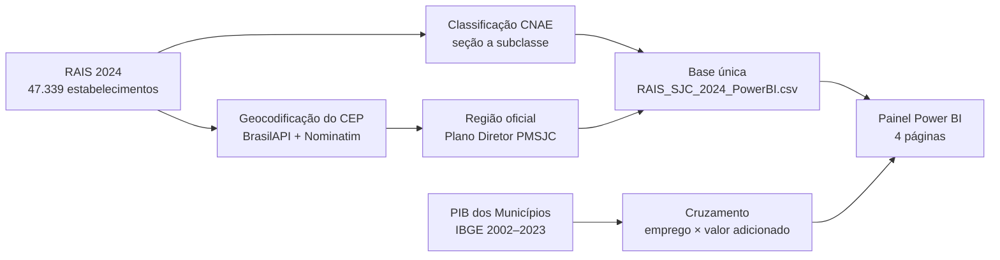
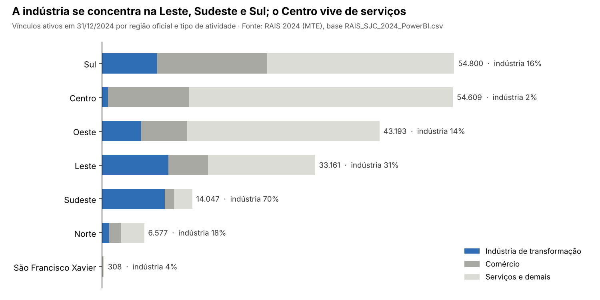
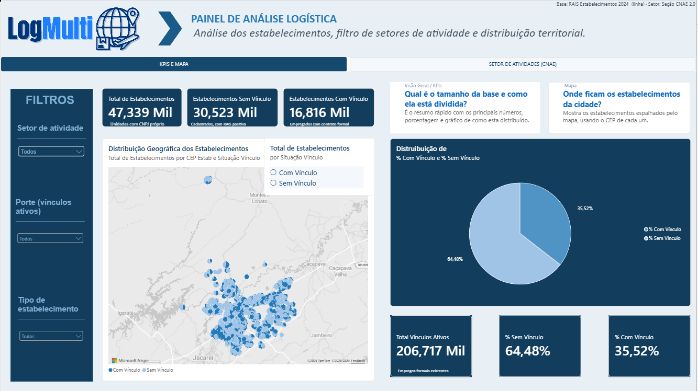
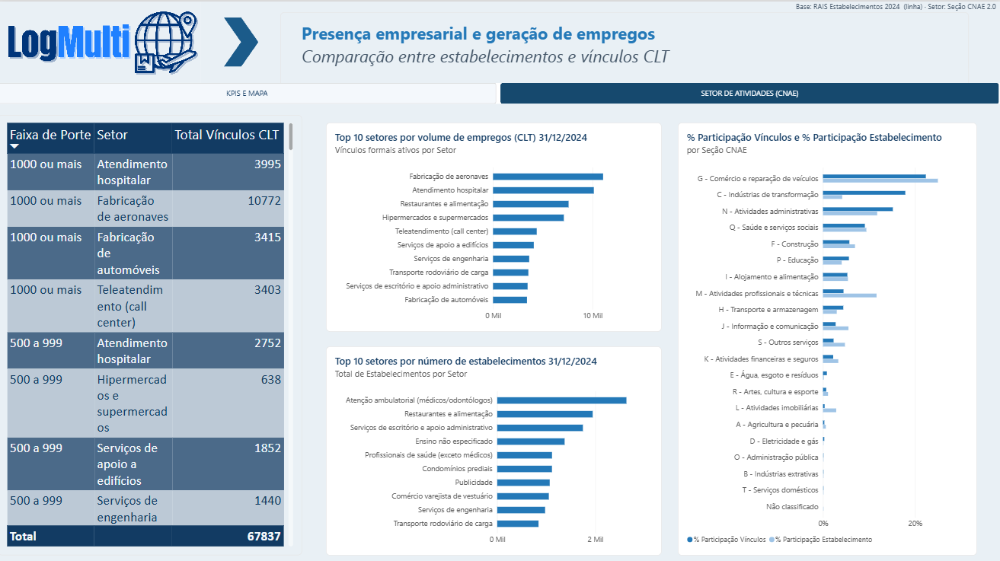

# 📌 MVP - [Análises centrais e mapeamento geográfico do ecossistema de São José dos Campos no Power BI]

## 🎯 Objetivo do MVP

> O MVP da Sprint 2 transforma a base tratada da RAIS em um painel no Power BI que mostra **quais setores predominam, onde as empresas estão e quanto cada setor pesa no emprego e na economia** de São José dos Campos.

- Qual problema resolve? A Secretaria de Desenvolvimento Econômico e o CADI não conseguem ver, num só lugar, a composição setorial do emprego formal, o porte e a situação das empresas, a distribuição pela cidade e a relação com o PIB municipal.

- Qual hipótese será validada? A hipótese de que a RAIS, classificada pela CNAE, geocodificada pelo CEP e cruzada com o PIB dos Municípios (IBGE), basta para descrever o perfil produtivo do município e apoiar decisões de política pública.

- Qual valor será entregue ao usuário final? Um painel navegável com indicadores gerais, ranking de setores, análise de porte e situação, cruzamento emprego × valor adicionado e uma base pronta para o mapa por região oficial da Prefeitura.

---

## 📝 Descrição da Solução

> Base RAIS 2024 de São José dos Campos classificada pela CNAE 2.3, geocodificada no nível de bairro e associada às regiões oficiais do município, integrada à série do PIB dos Municípios (IBGE) e visualizada em quatro páginas do Power BI.

- Funcionalidades principais incluídas:
  - **KPIs e Mapa:** total de estabelecimentos, com e sem vínculo, vínculos ativos e percentuais, com filtros por seção CNAE, porte e tipo de estabelecimento.
  - **Setor de Atividades (CNAE):** participação de cada seção nos estabelecimentos e nos vínculos, Top 10 setores por estabelecimentos e por empregos CLT, tabela por porte.
  - **PIB e Emprego:** PIB de 2002 a 2023 corrigido pelo IPCA, variação anual, valor adicionado por setor e produtividade relativa (participação no valor adicionado ÷ participação no emprego).
  - **Notas Metodológicas:** fontes, definições, limites e decisões da equipe.
  - **Base única para o mapa:** CEP, latitude, longitude, bairro, região oficial, CNAE 2.3, porte (faixa RAIS e SEBRAE), tipo de atividade, intensidade tecnológica (OCDE) e situação do estabelecimento.

- Limitações conhecidas:
  - A RAIS disponível tem **um único ano (2024)**: não dá para mostrar a evolução dos setores (US08) nem as contratações por data (US10).
  - O IBGE só detalha o valor adicionado por setor **até 2021**; o cruzamento compara estruturas de anos diferentes (VAB 2021 × emprego 2024).
  - Os pontos do mapa são o **centro do bairro**, não o endereço da empresa; 22% dos estabelecimentos ainda não têm ponto (CEPs de avenida e bairros não encontrados).
  - A lista oficial de bairros da **Região Norte** não está no documento do Plano Diretor e foi completada com fonte secundária.
  - Sem identificação nominal das empresas (DEC-004): rankings são por setor.

- Escopo reduzido: o mapa por coordenadas, os visuais por região e tipo de atividade e a série histórica dos setores ficam para a Sprint 3.

---

## 👥 Personas / Usuários-Alvo

- **Persona 1:** Gestor público (usuário do observatório): quer saber quais setores concentram empresas e empregos, onde estão e quanto geram de valor, para direcionar fomento, investimento e qualificação.
- **Persona 2:** Cliente (CADI e Secretaria de Desenvolvimento Econômico): quer um painel no formato do Observatório da Inovação RS, com fontes e limites explicados.
- **Persona 3:** Analista de mercado: quer comparar segmentos industriais e de serviços e o porte das empresas da cidade.

---

## 🔑 User Stories (Backlog do MVP)

| ID   | User Story | Prioridade | Status |
| ---- | ---------- | ---------- | ------ |
| US06 | Como gestor público (usuário do observatório), quero visualizar a distribuição geográfica das empresas de SJC no mapa, para que eu possa identificar polos e vazios industriais na cidade. | 2 | Parcial |
| US07 | Como gestor público, quero ver um ranking das empresas que mais contratam em SJC, para que eu possa direcionar políticas de fomento ao emprego. | 7 | Concluído |
| US08 | Como gestor público, quero identificar quais setores/áreas estão em alta em termos de contratação, para que eu possa priorizar investimentos e qualificação de mão de obra. | 8 | Parcial |
| US09 | Como gestor público, quero visualizar o impacto do ecossistema de empresas no PIB municipal (dados do IBGE), para que eu possa avaliar a relevância econômica de cada setor. | 9 | Concluído |

> US06 e US08 continuam na Sprint 3: a base do mapa está pronta, mas o visual ainda localiza pelo texto do CEP; a evolução dos setores depende de RAIS de outros anos.

---

## 📅 Sprint(s) Relacionadas

| Sprint | Entregas Principais | Entrega | Status |
| ------ | ------------------- | ------- | ------ |
| 01 | US01 a US05: ETL em Colab, CSVs tratados, Log de Decisões (DEC-001 a DEC-005), documentação Scrum e repositório no GitHub | 28/09/2026 | Concluído |
| 02 | US06 a US09: painel com KPIs, setores (CNAE), PIB e emprego; base geocodificada com região oficial; Log de Decisões até DEC-022 | 26/10/2026 | Entregue (2 concluídas, 2 parciais) |
| 03 | Restante de US06 e US08, US10 e US11: mapa por coordenadas, dashboard consolidado, relatório final e apresentação | 23/11/2026 | A fazer |

---

## 📊 Critérios de Aceitação

| US | Critério | Resultado |
| -- | -------- | --------- |
| US06 | Mapa no Power BI plota os estabelecimentos geocodificados a partir do CEP com taxa de acerto acima de 90%. | 99,99% com região oficial; 78,3% com ponto no mapa. Falta trocar o mapa para latitude/longitude. |
| US07 | Visual lista os estabelecimentos ordenados por vínculos ativos, com filtro por setor (agregado — DEC-004). | Top 10 de setores por estabelecimentos e por empregos CLT, com filtros por seção, porte e tipo. |
| US08 | Visual mostra a evolução de contratações por setor (CNAE agrupado). | Participação por setor disponível; evolução depende de série histórica. |
| US09 | Dashboard cruza RAIS 2024 e PIB dos Municípios por setor, com fonte, ano e defasagem indicados. | Página PIB e Emprego com anos de cada fonte e produtividade relativa. |

---

## 📈 Métricas de Validação

| Métrica | Valor |
| ------- | ----- |
| Estabelecimentos na base | 47.339 |
| Com vínculos ativos em 31/12/2024 | 15.058 (31,8%) |
| Vínculos ativos em 31/12/2024 | 206.717 |
| Estabelecimentos com região oficial | 47.334 (99,99%) |
| Estabelecimentos com ponto no mapa | 37.084 (78,3%) |
| Códigos CNAE válidos na CNAE 2.3 | 47.323 (99,97%) |
| Vínculos em atividades de alta e média-alta tecnologia (OCDE) | 28.804 (13,9%) |
| Indústria: participação no emprego privado × valor adicionado privado | 24,7% × 45,8% (índice 1,86) |
| PIB de São José dos Campos em 2023 | R$ 61,4 bilhões |
| Decisões de dados registradas | 22 (DEC-001 a DEC-022) |

---

## 🚀 Próximos Passos

- Importar a base única no Power BI e trocar o mapa do texto do CEP para **latitude/longitude**, com legenda por região oficial (US06).
- Pedir à Prefeitura, via cliente, a **tabela oficial bairro → região** (com a Região Norte) ou o shapefile das regiões.
- Definir com o cliente a fonte para a **evolução dos setores** (RAIS 2022–2023) e para as **contratações recentes** (RAIS Vínculos), ou ajustar os critérios de US08 e US10.
- Criar os visuais por região, tipo de atividade, intensidade tecnológica e porte SEBRAE.
- Corrigir os subtítulos de três cartões da página KPIs (total inclui CAEPF e CNO; "com vínculo" conta estabelecimentos, não pessoas).
- Sprint 3 (23/11/2026): consolidar o dashboard, o relatório técnico final e a apresentação da Feira de Soluções (03/12/2026).

---

## 🖥️ Telas do MVP

### Página 1 — KPIs e Mapa

Cartões com o total de estabelecimentos (47.339), com e sem vínculo e vínculos ativos (206.717); pizza com 35,52% com vínculo e 64,48% sem vínculo; mapa dos estabelecimentos por CEP; filtros por setor (Seção CNAE), porte e tipo de estabelecimento.

### Página 2 — Setor de Atividades (CNAE)

Top 10 setores por empregos CLT (fabricação de aeronaves, atendimento hospitalar e restaurantes na frente) e por número de estabelecimentos; participação de cada Seção CNAE em vínculos × estabelecimentos; tabela de vínculos CLT por faixa de porte e setor.

> As páginas **PIB e Emprego** e **Notas Metodológicas** estão na versão `PowerbiATT_Api_Sprint2.pbix` e ainda precisam ser trazidas para a versão atual do painel. A região oficial e o mapa por coordenadas entram na Sprint 3 (US06).

---

## 📂 Anexos / Evidências

- Relatório da Sprint 2: [`RELATORIO_SPRINT_2.md`](../RELATORIO_SPRINT_2.md)
- Documentação (Backlog da Sprint 2, Log de Decisões, Relatório Técnico, Anexo 8): `docs/`
- Base única para o Power BI: [`dados/RAIS_SJC_2024_PowerBI.csv`](../dados/RAIS_SJC_2024_PowerBI.csv) — guia em [`evidencias/Importacao_PowerBI_RAIS_SJC.txt`](../evidencias/Importacao_PowerBI_RAIS_SJC.txt)
- Notebook que gera a base (Google Colab): [`notebooks/02_Base_PowerBI_SJC.ipynb`](../notebooks/02_Base_PowerBI_SJC.ipynb) · dicionário de dados em [`dados/README.md`](../dados/README.md)
- Planilhas tratadas: [`dados/CNAE_RAIS_SJC_2024.xlsx`](../dados/CNAE_RAIS_SJC_2024.xlsx) e [`dados/IBGE_PIB_SJC_Observatorio.xlsx`](../dados/IBGE_PIB_SJC_Observatorio.xlsx)
- Painel: [`powerbi/Powerbi_API_Sprint2.pbix`](../powerbi/Powerbi_API_Sprint2.pbix) (versão atual, com [PDF](../powerbi/Powerbi_API_Sprint2.pdf) e [modelo .pbit](../powerbi/Powerbi_API_Sprint2.pbit)) e [`powerbi/PowerbiATT_Api_Sprint2.pbix`](../powerbi/PowerbiATT_Api_Sprint2.pbix) (versão com as páginas PIB e Emprego e Notas Metodológicas) — ver [`powerbi/README.md`](../powerbi/README.md)
- Relatório do Power BI (fontes, medidas DAX e leitura de cada visual): [`docs/Relatorio_PowerBI_Sprint2.md`](../docs/Relatorio_PowerBI_Sprint2.md)
- Vídeo de incremento da Sprint 2: *(adicionar link do YouTube)*
- Referência do projeto: [Observatório da Inovação RS](https://sict.rs.gov.br/observatorio)

### Log de Decisões de Dados — Sprint 2

| ID | Problema | Decisão | Status |
| -- | -------- | ------- | ------ |
| DEC-006 / 009 | IBGE só detalha o valor adicionado por setor até 2021 | Comparar VAB 2021 com o emprego de 2024, mostrando o ano de cada fonte | Fechada |
| DEC-008 | Valores do PIB de anos diferentes não são comparáveis | Corrigir pelo IPCA para reais de 2023 | Fechada |
| DEC-011 | 53 registros com indicador de RAIS negativa = 2 (fora do dicionário) | Categoria própria, somada a "Sem vínculo" | Fechada |
| DEC-013 | Administração pública ausente da base RAIS, mas presente no PIB | Excluir do cruzamento (204.331 vínculos CNPJ privados) | Fechada |
| DEC-014 | Era preciso um nível único de setor | Seção CNAE 2.0, padrão IBGE | Fechada |
| DEC-015 | Região oficial ausente dos arquivos | Bairro → região pelo Plano Diretor; setor do CEP para ambíguos | **Aberta** |
| DEC-016 | Coordenadas do arquivo de CEPs corrompidas pelo Excel | Usar as coordenadas corretas do outro arquivo; importar com localidade en-US | Fechada |
| DEC-017 | 9 bairros geocodificados em homônimos (331 estabelecimentos) | Marcar na coluna Alerta Coordenada e regeocodificar | **Aberta** |
| DEC-018 | CEPs de avenida e bairros não encontrados (10.255 sem ponto) | Sem ponto no mapa; região pelo bairro | Fechada |
| DEC-019 | "Com vínculo" inclui 1.758 que fecharam o ano sem empregados | Nova coluna Situação Detalhada | Fechada |
| DEC-020 | Descrições CNAE com grafia antiga | Texto oficial da CNAE 2.3; códigos mantidos | Fechada |
| DEC-021 | Requisitos pedem tipo de atividade e intensidade tecnológica | Colunas Tipo de Atividade, OCDE, Porte SEBRAE e Setor Destaque | Fechada |
| DEC-022 | Mapa localizava pelo texto do CEP | Base única com latitude/longitude para substituir a fonte do painel | **Aberta** |

> DEC-007, DEC-010 e DEC-012 foram numeradas pela equipe e ainda precisam ser transcritas para o Log de Decisões (`docs/06-Decisoes-de-Dados.docx`).
