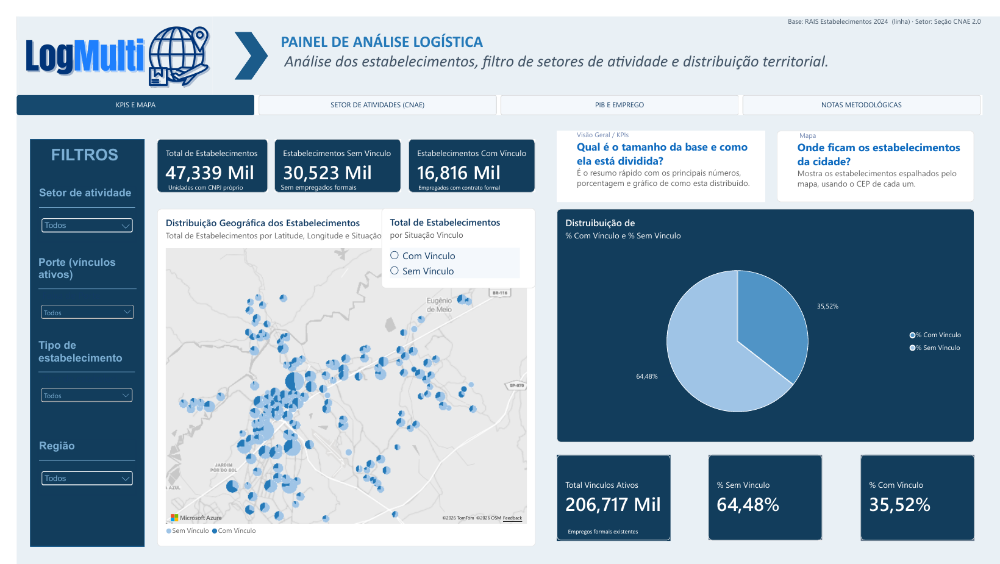
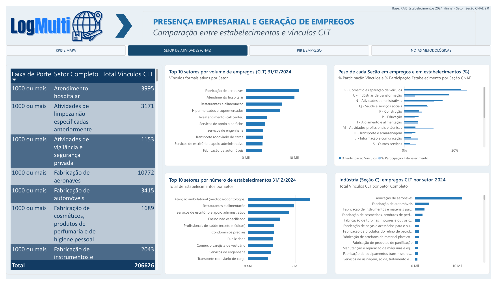
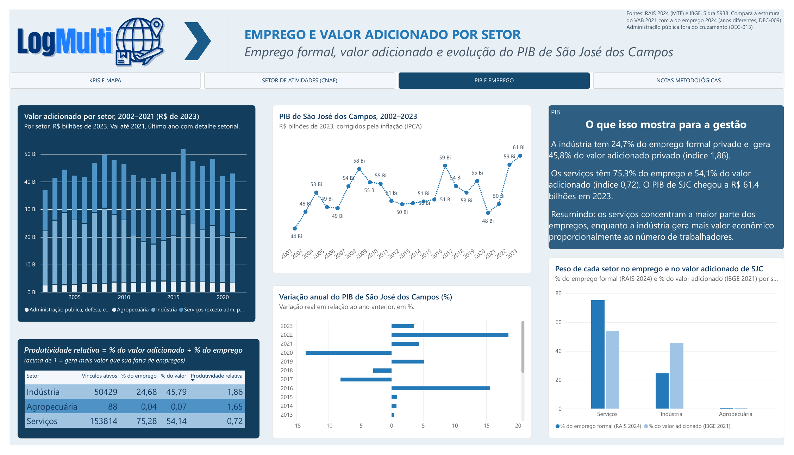
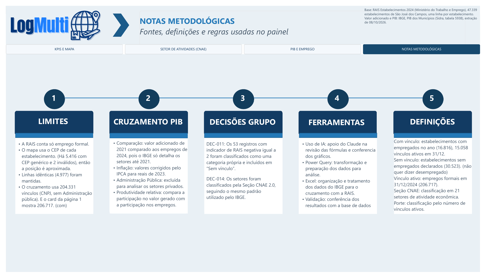

# 📌 MVP - Sprint 3 · Consolidação do Observatório do Ecossistema Industrial e de Serviços de São José dos Campos

> **Entrega:** 23/11/2026 · **Status:** Entregue (painel consolidado publicado; US06 concluída nos dados com 99,99% dos estabelecimentos no mapa; US08 parcial; US10 sem fonte de dados) · Apresentação final na Feira de Soluções (03/12/2026) · [Relatório da Sprint 3](../docs/RELATORIO_SPRINT_3.md) · [voltar ao README](../README.md)

> 🌐 **Painel publicado:** [abrir no Power BI](https://app.powerbi.com/view?r=eyJrIjoiMDdlOThiMzQtNWQ5Ny00Mzk1LWI0YWEtNGM2NzAzZmNhNDRmIiwidCI6ImVhYmU2NGM1LTY4ZjUtNGE3Ni04MzAxLTk1NzdhNjc5ZTQ0OSIsImMiOjR9) (abre no navegador, sem login)
>
> ▶️ **Vídeos do projeto:** [canal LogMulti no YouTube](https://www.youtube.com/@LogMulti)

## 🎯 Objetivo do MVP

> O MVP da Sprint 3 fecha o observatório: um painel único no Power BI, nos moldes do [Observatório da Inovação RS](https://sict.rs.gov.br/observatorio), que reúne os indicadores das sprints anteriores, mostra o mapa da cidade por região oficial e vem acompanhado da documentação final, do vídeo do projeto e da apresentação ao cliente.

- Qual problema resolve? A Secretaria de Desenvolvimento Econômico e o CADI não tinham uma versão final, publicada e documentada, que pudessem abrir e usar sozinhos para acompanhar o ecossistema produtivo do município.

- Qual hipótese será validada? A hipótese de que um painel consolidado, com fontes e limites explicados, é suficiente para que a Secretaria acompanhe o ecossistema produtivo do município e use o observatório na tomada de decisão. A validação com o cliente acontece na Feira de Soluções (03/12/2026).

- Qual valor será entregue ao usuário final? Uma ferramenta pronta para consulta: painel publicado com acesso pelo navegador, sem login, base única documentada, notebooks para refazer o tratamento com uma nova RAIS e um vídeo que mostra como usar o painel.

---

## 📝 Descrição da Solução

> Painel Power BI sobre a RAIS 2024 de São José dos Campos classificada pela CNAE 2.3, geocodificada pelo CEP (CNEFE 2022) e cruzada com o PIB dos Municípios (IBGE). O link publicado ainda mostra a versão de 4 páginas da Sprint 2; o projeto `.pbip` do repositório tem a versão da Sprint 3, com 5 páginas, que vai para o link quando o painel for republicado.

- Funcionalidades principais entregues:
  - **KPIs e Mapa:** total de estabelecimentos, com e sem vínculo, vínculos ativos; mapa por latitude e longitude; filtros por seção CNAE, porte, tipo de estabelecimento e **região oficial**.
  - **Setor de Atividades (CNAE):** Top 10 setores por estabelecimentos e por empregos CLT, participação de cada seção, indústria (Seção C) por setor e tabela por porte.
  - **PIB e Emprego:** PIB 2002–2023 corrigido pelo IPCA, variação anual, valor adicionado por setor e produtividade relativa.
  - **Notas Metodológicas:** fontes, definições, limites e decisões da equipe.
  - **Regiões e Tecnologia (nova, 23/11/2026):** vínculos por região oficial, por tipo de atividade, por intensidade tecnológica (OCDE) e por macroprocesso logístico (DEC-024), com filtro de região. Responde às perguntas 2 a 5 do cliente.
  - **Documentação de entrega:** relatório da Sprint 3, Log de Decisões (DEC-001 a DEC-024), [respostas a cada requisito do cliente](../docs/Respostas_Requisitos_Cliente.md), notebooks 01, 01b e 02 para reproduzir a base, dicionário de dados e guia para abrir e atualizar o painel.
  - **Canal LogMulti no YouTube**, para o vídeo de apresentação do projeto (gravação de tela do GitHub e do painel, até 5 minutos).

- Limitações conhecidas:
  - **Mapa:** com as coordenadas do CNEFE 2022 (DEC-023), 99,99% dos estabelecimentos têm ponto, no nível do CEP. O ponto é o centro dos endereços do CEP, não o endereço exato da empresa; nos CEPs genéricos (5.413 estabelecimentos) ele é aproximado. A versão publicada do painel só mostra isso depois de atualizada e republicada.
  - **Um único ano de RAIS (2024):** não dá para mostrar a evolução dos setores (US08).
  - **Sem data de admissão** na RAIS Estabelecimentos: a US10 não tem fonte na base atual.
  - A Região Norte não tem lista oficial de bairros no Plano Diretor (DEC-015 aberta).
  - Sem identificação nominal das empresas (DEC-004): os rankings são por setor.

- Escopo reduzido: sem novas fontes além da RAIS 2024 e do PIB dos Municípios, sem atualização automática e sem alterar o painel publicado na Sprint 2. As melhorias sugeridas estão em [Próximos passos](#-próximos-passos-e-melhorias-sugeridas).

---

## 👥 Personas / Usuários-Alvo

- **Persona 1:** Gestor público (usuário do observatório): quer ver no mapa onde estão os polos e vazios produtivos da cidade e quais setores pesam mais no emprego e no PIB, para direcionar fomento, investimento e qualificação.
- **Persona 2:** Cliente (CADI e Secretaria de Desenvolvimento Econômico): quer receber uma ferramenta final, documentada e pronta para uso, com o vídeo e a apresentação.
- **Persona 3:** Analista de mercado: quer comparar regiões, setores e porte dos estabelecimentos de São José dos Campos.

---

## 🔑 User Stories (Backlog do MVP)

| ID   | User Story | Prioridade | Estimativa | Status |
| ---- | ---------- | ---------- | ---------- | ------ |
| US06 | Como gestor público (usuário do observatório), quero visualizar a distribuição geográfica das empresas de SJC no mapa, para que eu possa identificar polos e vazios industriais na cidade. *(restante da Sprint 2)* | Alta | 13 pontos | Concluída nos dados (99,99% com ponto pelo CNEFE 2022, DEC-023); falta republicar o painel |
| US08 | Como gestor público, quero identificar quais setores/áreas estão em alta em termos de contratação, para que eu possa priorizar investimentos e qualificação de mão de obra. *(restante da Sprint 2)* | Média | 8 pontos | Parcial (participação e ranking por setor; evolução depende da RAIS 2022–2023) |
| US10 | Como gestor público, quero acompanhar as contratações mais recentes registradas na RAIS, para que eu possa monitorar a dinâmica do mercado de trabalho local. | Baixa | 5 pontos | Não iniciada (a base não tem data de admissão; critério a revisar com o cliente) |
| US11 | Como cliente (CADI / Secretaria de Desenvolvimento Econômico), quero um dashboard consolidado no Power BI, nos moldes do Observatório da Inovação RS, acompanhado do relatório técnico final e da apresentação, para que eu possa usar a ferramenta na tomada de decisão. | Alta | 13 pontos | Parcial (painel único publicado e documentado; apresentação e aprovação na Feira de Soluções) |

> Detalhamento no [Backlog da Sprint 3](../docs/09-Backlog-Sprint-3.md) e no [Relatório da Sprint 3](../docs/RELATORIO_SPRINT_3.md).

---

## 📅 Sprint(s) Relacionadas

| Sprint | Entregas Principais | Entrega | Status |
| ------ | ------------------- | ------- | ------ |
| 01 | US01 a US05: ETL em Colab, CSVs tratados, Log de Decisões (DEC-001 a DEC-005), documentação Scrum e repositório no GitHub | 28/09/2026 | Concluído ([MVP](sp1.md)) |
| 02 | US06 a US09: painel com KPIs, setores (CNAE), PIB e emprego; base geocodificada com região oficial; Log de Decisões até DEC-022 | 26/10/2026 | Concluído, 2 parciais ([MVP](sp2.md)) |
| 03 | Restante de US06 e US08, US10 e US11: painel consolidado publicado, documentação final e vídeo no canal LogMulti | 23/11/2026 | Entregue |
| Feira de Soluções | Apresentação final do observatório ao cliente | 03/12/2026 | A fazer |

---

## 📊 Critérios de Aceitação

| US | Critério | Resultado |
| -- | -------- | --------- |
| US06 | O mapa no Power BI plota os estabelecimentos geocodificados a partir do CEP, com taxa de acerto acima de 90%, e filtra pelas regiões oficiais do município. | Mapa por latitude/longitude e filtro por região no painel. Com o CNEFE 2022 (DEC-023), 47.334 estabelecimentos (99,99%) com ponto na base e na planilha do mapa: **meta atingida**; o link publicado mostra 78,3% até o painel ser republicado. |
| US08 | Visual mostra a evolução de contratações por setor (CNAE agrupado), ou o critério revisado com o cliente está registrado no Log de Decisões. | Participação e Top 10 por setor no painel; sem série histórica e sem critério revisado registrado. |
| US10 | O painel exibe as contratações do período mais recente disponível, ordenadas por data, ou o critério revisado com o cliente está registrado no Log de Decisões. | Não atendido: a RAIS Estabelecimentos não tem data de admissão. |
| US11 | O dashboard publicado reúne todos os visuais das sprints anteriores; relatório técnico final e apresentação entregues e aprovados pelos orientadores. | Painel único publicado (4 páginas) e versão de 5 páginas no `.pbip`, com a página Regiões e Tecnologia; relatório da Sprint 3 e respostas a cada requisito do cliente entregues; canal LogMulti criado para o vídeo; apresentação e aprovação na Feira (03/12). |

---

## 📈 Métricas de Validação

| Métrica | Meta | Resultado |
| ------- | ---- | --------- |
| Estabelecimentos com ponto no mapa | acima de 90% | 47.334 de 47.339 (99,99%) com o CNEFE 2022; antes, 37.084 (78,3%) |
| Vínculos ativos em estabelecimentos com ponto no mapa | — | 206.700 de 206.717 (99,99%); antes, 146.702 (71,0%) |
| Estabelecimentos com região oficial | 100% | 47.334 (99,99%) |
| Decisões de dados em aberto | DEC-015, DEC-017 e DEC-022 resolvidas ou com encaminhamento | DEC-017 fechada pela DEC-023; DEC-015 e DEC-022 abertas, com encaminhamento registrado |
| Usuários que testaram o MVP | equipe, orientadores e cliente | equipe; orientadores e cliente na Feira de Soluções |
| Feedback qualitativo do cliente | aprovação do painel final | a coletar na Feira de Soluções (03/12/2026) |

---

## 🚀 Próximos passos e melhorias sugeridas

**Até a Feira de Soluções (03/12/2026)**

- Publicar o vídeo de apresentação no [canal LogMulti](https://www.youtube.com/@LogMulti) e colocar o link direto do vídeo aqui e no README.
- ✅ Ajustes visuais da página 1 feitos no `.pbip` (cartões sem "Mil", título da pizza e subtítulos de dois cartões). Falta abrir no Power BI Desktop e republicar para o link mostrar a correção (ver [`powerbi/README.md`](../powerbi/README.md)).
- Levar à Feira um QR Code para o painel publicado e outro para o repositório.
- Perguntar ao cliente, na apresentação, se aceita revisar os critérios de US08 e US10 (ver abaixo) e registrar a resposta no Log de Decisões.
- Confirmar com o cliente se a pergunta sobre oportunidades profissionais deve ser respondida para o profissional de logística, como fizemos, ou para o engenheiro de produção, como está no documento de requisitos.
- Abrir o `.pbip` no Power BI Desktop, atualizar tudo e republicar: o link passa a mostrar o mapa com 99,99%, a página Regiões e Tecnologia e os ajustes da página 1 (passo a passo em [`powerbi/README.md`](../powerbi/README.md)).

**Melhorias sugeridas para o painel e os dados**

| # | Melhoria | Por quê | Esforço |
| - | -------- | ------- | ------- |
| 1 | ✅ **Feito em 23/11 (DEC-023).** Coordenadas do mapa pelo CNEFE 2022 (IBGE) na base única e na planilha do mapa | 47.334 dos 47.339 estabelecimentos (99,99%) com ponto, no nível do CEP | Concluído; falta republicar o painel |
| 2 | Trocar a fonte da tabela RAIS_SJC do painel pela base única (DEC-022). Os homônimos (DEC-017) já foram resolvidos pela DEC-023 | Painel e base com a mesma região (a planilha do painel deixa 603 sem região; a base única, 5) | Médio |
| 3 | ✅ **Feito em 23/11.** Página "Regiões e Tecnologia" no `.pbip`, com região, tipo de atividade, intensidade tecnológica (OCDE) e macroprocesso logístico (DEC-024) | Responde às perguntas 2 a 5 do cliente dentro do painel | Concluído; falta republicar |
| 4 | Processar a RAIS 2022 e 2023 pelo notebook 01 | Permite mostrar a evolução dos setores (US08) | Médio (arquivos de cerca de 3 GB cada) |
| 5 | Revisar com o cliente o critério da US10: usar a RAIS Vínculos (mês de admissão) ou trocar por "estabelecimentos com atividade no ano" | A base atual não tem data de admissão | Baixo para decidir; médio para implementar |
| 6 | ✅ Feito em 23/11: parâmetro `PastaFontes` no lugar dos caminhos `C:\Users\...`, projeto renomeado para `Observatorio_SJC` e `.pbix` antigos em `powerbi/versoes_anteriores/` | Qualquer integrante ou o cliente consegue atualizar o painel | Concluído; a aba "PIB anual" também foi incluída em `powerbi/fontes/`, então as 6 tabelas atualizam a partir do repositório |
| 7 | Transcrever DEC-007, DEC-010 e DEC-012 para o Log de Decisões | O log fica completo para a entrega final | Baixo |

---

## 📂 Anexos / Evidências

- Relatório da Sprint 3: [`docs/RELATORIO_SPRINT_3.md`](../docs/RELATORIO_SPRINT_3.md)
- **Respostas aos requisitos do cliente** (7 perguntas, funcionalidades, resultados e RN.P): [`docs/Respostas_Requisitos_Cliente.md`](../docs/Respostas_Requisitos_Cliente.md)
- Backlog da Sprint 3: [`docs/09-Backlog-Sprint-3.md`](../docs/09-Backlog-Sprint-3.md)
- Log de Decisões de Dados: [`docs/06-Decisoes-de-Dados.md`](../docs/06-Decisoes-de-Dados.md)
- **Painel publicado:** [abrir no Power BI](https://app.powerbi.com/view?r=eyJrIjoiMDdlOThiMzQtNWQ5Ny00Mzk1LWI0YWEtNGM2NzAzZmNhNDRmIiwidCI6ImVhYmU2NGM1LTY4ZjUtNGE3Ni04MzAxLTk1NzdhNjc5ZTQ0OSIsImMiOjR9) · projeto [`powerbi/pbip/Observatorio_SJC.pbip`](../powerbi/pbip/) e planilhas em [`powerbi/fontes/`](../powerbi/fontes/) · [PDF das 4 páginas](../powerbi/Powerbi_API_Sprint2.pdf)
- Base única e dicionário de dados: [`dados/RAIS_SJC_2024_PowerBI.csv`](../dados/RAIS_SJC_2024_PowerBI.csv) · [`dados/README.md`](../dados/README.md)
- Notebooks: [`01_ETL_RAIS_SJC.ipynb`](../notebooks/01_ETL_RAIS_SJC.ipynb) · [`01b_Geocodificacao_CEPs_SJC.ipynb`](../notebooks/01b_Geocodificacao_CEPs_SJC.ipynb) · [`02_Base_PowerBI_SJC.ipynb`](../notebooks/02_Base_PowerBI_SJC.ipynb) · abrir no Colab: [01](https://colab.research.google.com/github/projetoapi08/Observat-rio-do-Ecossistema-Industrial-e-de-Servi-os-de-S-o-Jos-dos-Campos/blob/main/notebooks/01_ETL_RAIS_SJC.ipynb) · [01b](https://colab.research.google.com/github/projetoapi08/Observat-rio-do-Ecossistema-Industrial-e-de-Servi-os-de-S-o-Jos-dos-Campos/blob/main/notebooks/01b_Geocodificacao_CEPs_SJC.ipynb) · [02](https://colab.research.google.com/github/projetoapi08/Observat-rio-do-Ecossistema-Industrial-e-de-Servi-os-de-S-o-Jos-dos-Campos/blob/main/notebooks/02_Base_PowerBI_SJC.ipynb)
- Códigos de tratamento de dados (evidência): [`evidencias/codigos-tratamento-dados.md`](../evidencias/codigos-tratamento-dados.md)
- **Vídeo do MVP:** [canal LogMulti no YouTube](https://www.youtube.com/@LogMulti)

### Prints de tela do MVP

O painel publicado é o mesmo da Sprint 2; os prints estão em `evidencias/sprint2/`.

| KPIs e Mapa | Setor de Atividades (CNAE) |
| :---: | :---: |
|  |  |
| **PIB e Emprego** | **Notas Metodológicas** |
|  |  |
