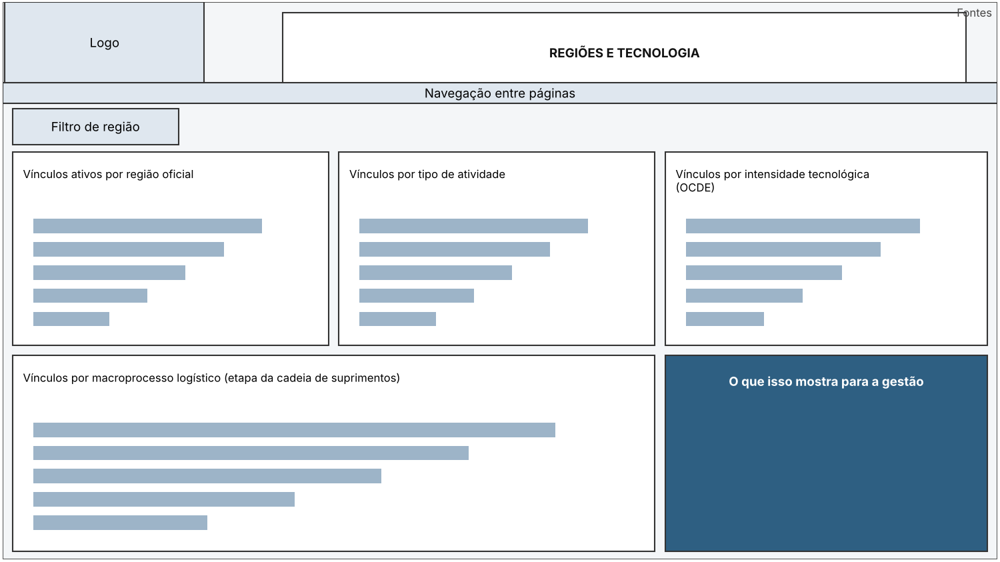

> Versão em Markdown de [`Guia_Atualizar_PowerBI.docx`](Guia_Atualizar_PowerBI.docx), para leitura direta no GitHub. Em caso de diferença, vale o .docx. · [voltar ao índice da documentação](../README.md)

# Guia passo a passo: atualizar e republicar o painel Power BI

Observatório do Ecossistema Industrial e de Serviços de São José dos Campos · versão de 23/11/2026 (Sprint 3)

Este guia leva a versão final do painel, que está no repositório do GitHub, para o link público que o cliente abre. Leva cerca de 30 minutos e deve ser feito por quem publicou o painel da primeira vez (ou por alguém com acesso ao mesmo workspace do Power BI).

## O que muda no painel

| **Mudança**                                                                                                                            | **Onde aparece**                          | **Referência**   |
|----------------------------------------------------------------------------------------------------------------------------------------|-------------------------------------------|------------------|
| Mapa com ponto para 99,99% dos estabelecimentos (antes 78,3%), pelas coordenadas do CNEFE 2022 do IBGE                                 | Página KPIs e Mapa                        | DEC-023          |
| Página nova **Regiões e Tecnologia**: vínculos por região, tipo de atividade, intensidade tecnológica (OCDE) e macroprocesso logístico | Entre PIB e Emprego e Notas Metodológicas | DEC-021, DEC-024 |
| Cartões sem "Mil", título da pizza corrigido e dois subtítulos novos                                                                   | Página KPIs e Mapa                        | —                |
| Planilhas lidas por uma pasta configurável (parâmetro **PastaFontes**) e aba PIB anual incluída                                        | Todas as tabelas                          | —                |

Nenhuma outra página muda. Os números de Setor de Atividades e de PIB e Emprego devem continuar iguais aos de hoje.

## Antes de começar

- **Power BI Desktop atualizado** (Microsoft Store ou site da Microsoft). Versões antigas podem não abrir projetos .pbip.

- **Conta do Power BI com acesso ao workspace** onde o painel está publicado hoje. É o que permite substituir o relatório sem mudar o link.

- **Internet** para baixar o repositório e publicar.

## Passo 1 — Baixar o repositório

1.  Abra o repositório no navegador: https://github.com/projetoapi08/Observat-rio-do-Ecossistema-Industrial-e-de-Servi-os-de-S-o-Jos-dos-Campos

2.  Clique no botão verde **Code** e depois em **Download ZIP**.

3.  Extraia o ZIP em **C:\Observatorio-SJC\\**. No fim, a pasta **C:\Observatorio-SJC\powerbi\fontes\\** deve existir.

4.  Confira se essa pasta tem os 4 arquivos: **RAIS_SJC.csv**, **Cruzamento_RAIS_IBGE_Observatorio_SJC.xlsx**, **dCNAE_classes.xlsx** e **Regioes_SJC_filtro_por_regiao.xlsx**.

> O Windows às vezes extrai o ZIP dentro de uma pasta com o nome do repositório. Se isso acontecer, mova o conteúdo para que o caminho fique exatamente C:\Observatorio-SJC\powerbi\fontes\\ ou ajuste o parâmetro no Passo 3.

## Passo 2 — Abrir o projeto

1.  Abra a pasta **C:\Observatorio-SJC\powerbi\pbip\\**.

2.  Dê dois cliques em **Observatorio_SJC.pbip**. As pastas Observatorio_SJC.Report e Observatorio_SJC.SemanticModel precisam continuar ao lado desse arquivo.

3.  O painel abre com as páginas, mas sem dados (o GitHub não guarda o cache de dados). Isso é esperado.

> Se o Power BI Desktop disser que não reconhece o formato do projeto, vá em **Arquivo → Opções e configurações → Opções → Recursos de visualização**, marque as opções de projeto do Power BI (.pbip), de formato TMDL e de formato de relatório PBIR, reinicie o Power BI e abra de novo.

## Passo 3 — Conferir a pasta das planilhas

1.  Clique em **Página Inicial → Transformar dados → Editar parâmetros**.

2.  O parâmetro **PastaFontes** deve ter o valor **C:\Observatorio-SJC\powerbi\fontes\\**, com a barra invertida no final.

3.  Se você extraiu o repositório em outro lugar, cole o caminho da sua pasta **powerbi\fontes\\** e clique em **OK**.

## Passo 4 — Atualizar os dados

1.  Clique em **Página Inicial → Atualizar**.

2.  Espere as 6 tabelas carregarem: RAIS_SJC, Cruzamento, PIB anual, VAB setorial, CEP x Região e dCNAE.

3.  Se aparecer alguma mensagem de erro, veja a tabela **Problemas comuns** no fim deste guia antes de continuar.

> Atualize tudo, e não só uma tabela. As três colunas novas da página Regiões e Tecnologia (Tipo de Atividade, Intensidade Tecnológica OCDE e Macroprocesso Logístico) são calculadas durante a atualização.

## Passo 5 — Conferir cada página

Compare o que aparece na tela com os valores esperados. Se algum valor estiver diferente, não publique: anote a página e o valor e peça ajuda (veja o fim do guia).

### KPIs e Mapa

| **O que conferir**     | **Valor esperado**                                                                                                   |
|------------------------|----------------------------------------------------------------------------------------------------------------------|
| Cartões                | 47.339 estabelecimentos · 30.523 sem vínculo · 16.816 com vínculo · 206.717 vínculos ativos, **sem a palavra "Mil"** |
| Pizza                  | Título "Distribuição dos estabelecimentos por situação de vínculo"; 64,48% sem vínculo e 35,52% com vínculo          |
| Subtítulos dos cartões | "Estabelecimentos na base" e "Com empregados no ano"                                                                 |
| Mapa                   | Pontos espalhados pela cidade inteira, inclusive nas avenidas e no Jardim Satélite, que antes ficavam vazios         |
| Filtro de região       | Ao escolher uma região, os cartões e o mapa mudam                                                                    |

### Setor de Atividades (CNAE) e PIB e Emprego

| **O que conferir**                        | **Valor esperado**                                 |
|-------------------------------------------|----------------------------------------------------|
| Top 10 por empregos (Setor de Atividades) | Fabricação de aeronaves na frente                  |
| PIB de 2023 (PIB e Emprego)               | R\$ 61 bilhões no gráfico de linha                 |
| Variação anual do PIB                     | Queda de 13,5% em 2020                             |
| Produtividade relativa                    | Indústria 1,86 · Agropecuária 1,65 · Serviços 0,72 |

### Regiões e Tecnologia (página nova)

A página fica entre PIB e Emprego e Notas Metodológicas e aparece sozinha no menu de navegação. O esquema abaixo mostra onde fica cada visual.

*Esquema da página Regiões e Tecnologia (posições reais dos visuais; as barras são ilustrativas).*

| **Gráfico**                                 | **Valores esperados (vínculos ativos, sem filtro)**                                                                                                                                                                                                      |
|---------------------------------------------|----------------------------------------------------------------------------------------------------------------------------------------------------------------------------------------------------------------------------------------------------------|
| Vínculos ativos por região oficial          | Sul 54.581 · Centro 54.055 · Oeste 43.228 · Leste 32.709 · Sudeste 13.942 · Norte 6.229 · Sem região 1.958 · em branco 15                                                                                                                                |
| Vínculos por tipo de atividade              | Comércio 46.228 · Manufatura 36.989 · Serviços administrativos 31.396 · Saúde e educação 30.491 · … · Logística e transporte 9.137 · Tecnologia, informação e P&D 6.249. Soma: 206.717                                                                   |
| Vínculos por intensidade tecnológica (OCDE) | Não se aplica 166.586 · Média-alta 14.406 · Alta 14.398 · Média-baixa 6.328 · Média 4.999                                                                                                                                                                |
| Vínculos por macroprocesso logístico        | Em ordem de 1 a 9: Suprimento 1.606 · Produção 46.695 · Distribuição atacadista 8.115 · Transporte e armazenagem 9.137 · Varejo 36.978 · Pós-venda 3.517 · Logística reversa 1.416 · Serviços de apoio 51.679 · Serviços ao consumidor e públicos 47.574 |
| Filtro de região                            | Ao escolher "Sudeste", Manufatura passa a ser o maior tipo de atividade                                                                                                                                                                                  |

> O gráfico por região usa a tabela CEP x Região do painel, por isso os números diferem um pouco dos documentos escritos, que usam a base única (onde ficam só 5 estabelecimentos sem região). Isso está registrado na DEC-022.

## Passo 6 — Ajustes visuais (opcional)

A página nova foi montada fora do Power BI Desktop, copiando o estilo das outras páginas. Se algo ficar fora do padrão, ajuste antes de publicar:

- **Cores das barras:** clique no gráfico → **Formatar visual → Barras → Cores** e use a mesma cor dos gráficos da página Setor de Atividades.

- **Rótulos cortados:** aumente a largura do gráfico ou, em **Eixo Y**, diminua o tamanho da fonte.

- **Ordem do gráfico de macroprocessos:** deve seguir de 1 a 9. Se não estiver, clique nos três pontos do gráfico → **Classificar eixo → Macroprocesso Logístico → Ordem crescente**.

- **Unidades:** os rótulos devem mostrar números inteiros (por exemplo, 46.228). Se aparecer "Mil", em **Rótulos de dados → Unidades de exibição**, escolha **Nenhum**.

## Passo 7 — Salvar

1.  Pressione **Ctrl + S**. O Power BI salva as alterações dentro da pasta pbip.

2.  Para o repositório, mantenha o formato de projeto (.pbip). Um .pbix só é usado, se preciso, para publicar com o nome antigo (veja o Passo 8).

## Passo 8 — Publicar no mesmo link

1.  Clique em **Página Inicial → Publicar** e entre com a conta do Power BI.

2.  Escolha o **mesmo workspace** onde o painel já está publicado.

3.  Quando o Power BI avisar que já existe um relatório com esse nome, escolha **Substituir**.

4.  Abra o link público em uma aba anônima do navegador e confira as 5 páginas: https://app.powerbi.com/view?r=eyJrIjoiMDdlOThiMzQtNWQ5Ny00Mzk1LWI0YWEtNGM2NzAzZmNhNDRmIiwidCI6ImVhYmU2NGM1LTY4ZjUtNGE3Ni04MzAxLTk1NzdhNjc5ZTQ0OSIsImMiOjR9

> **Atenção ao nome:** o Power BI publica com o nome do arquivo, que agora é **Observatorio_SJC**. Se o relatório publicado hoje no workspace tiver outro nome (por exemplo, "Powerbi Sprint2"), use **Arquivo → Salvar como** e salve um .pbix com esse nome antigo só para publicar. Assim o Power BI oferece **Substituir** e o link público continua o mesmo. Publicar com outro nome cria um relatório novo, e o link continua mostrando a versão antiga.
>
> O link de "Publicar na Web" pode levar alguns minutos para mostrar a versão nova; se demorar, recarregue a página com Ctrl + F5.

## Passo 9 — Registrar no GitHub

1.  Tire um print de cada uma das 5 páginas e salve como **painel_kpis_mapa.png**, **painel_setor_atividades.png**, **painel_pib_emprego.png**, **painel_regioes_tecnologia.png** e **painel_notas_metodologicas.png**.

2.  Exporte o painel em PDF: **Arquivo → Exportar → Exportar para PDF**.

3.  Envie os prints para a pasta **evidencias/sprint3/** e o PDF para a pasta **powerbi/** do repositório (no GitHub: abrir a pasta → **Add file → Upload files**), ou mande os arquivos para o Juliano, que atualiza o repositório.

4.  Se você fez ajustes no Passo 6, envie também a pasta **powerbi/pbip/** atualizada, sem a pasta oculta **.pbi** (ela guarda o cache local).

## Problemas comuns

| **O que aparece**                                                     | **Causa provável**                                                    | **O que fazer**                                                                                                                    |
|-----------------------------------------------------------------------|-----------------------------------------------------------------------|------------------------------------------------------------------------------------------------------------------------------------|
| "Não foi possível encontrar o arquivo C:\Observatorio-SJC\\"          | O repositório foi extraído em outra pasta                             | Ajuste o parâmetro PastaFontes (Passo 3) e atualize de novo                                                                        |
| Erro na tabela PIB anual ("a chave não correspondeu a nenhuma linha") | Planilha de cruzamento antiga, sem a aba PIB anual                    | Baixe o repositório de novo; a planilha atual tem a aba PIB anual                                                                  |
| Gráficos da página nova vazios ou com erro                            | Tabela RAIS_SJC não foi atualizada                                    | Atualize tudo (Passo 4). Se continuar, mande um print do erro                                                                      |
| Mapa em branco                                                        | Visual de mapa do Azure desativado na conta ou nas opções             | Em Arquivo → Opções → Segurança, permita os visuais de mapa; na conta da Fatec, o administrador pode precisar liberar o Azure Maps |
| Página Regiões e Tecnologia não aparece no menu                       | Página oculta                                                         | Clique com o botão direito na aba da página e desmarque "Ocultar página"                                                           |
| O .pbip não abre ou dá erro de formato                                | Power BI Desktop desatualizado ou recursos de visualização desligados | Atualize o Power BI Desktop e veja a nota do Passo 2                                                                               |
| O link público ainda mostra 4 páginas                                 | Publicado em outro workspace ou com outro nome                        | Veja a nota do Passo 8 e publique de novo substituindo o relatório certo                                                           |

Se o problema não estiver na tabela, tire um print da mensagem de erro e da tela e mande para o Juliano, com o nome da página e o passo em que parou.

## Checklist final

☐ Repositório baixado e extraído em C:\Observatorio-SJC\\

☐ Projeto Observatorio_SJC.pbip aberto e parâmetro PastaFontes conferido

☐ 6 tabelas atualizadas sem erro

☐ Valores das páginas conferidos com o Passo 5

☐ Painel salvo (Ctrl + S)

☐ Publicado no mesmo workspace, substituindo o relatório

☐ Link público conferido em aba anônima, com 5 páginas

☐ Prints e PDF enviados ao GitHub
