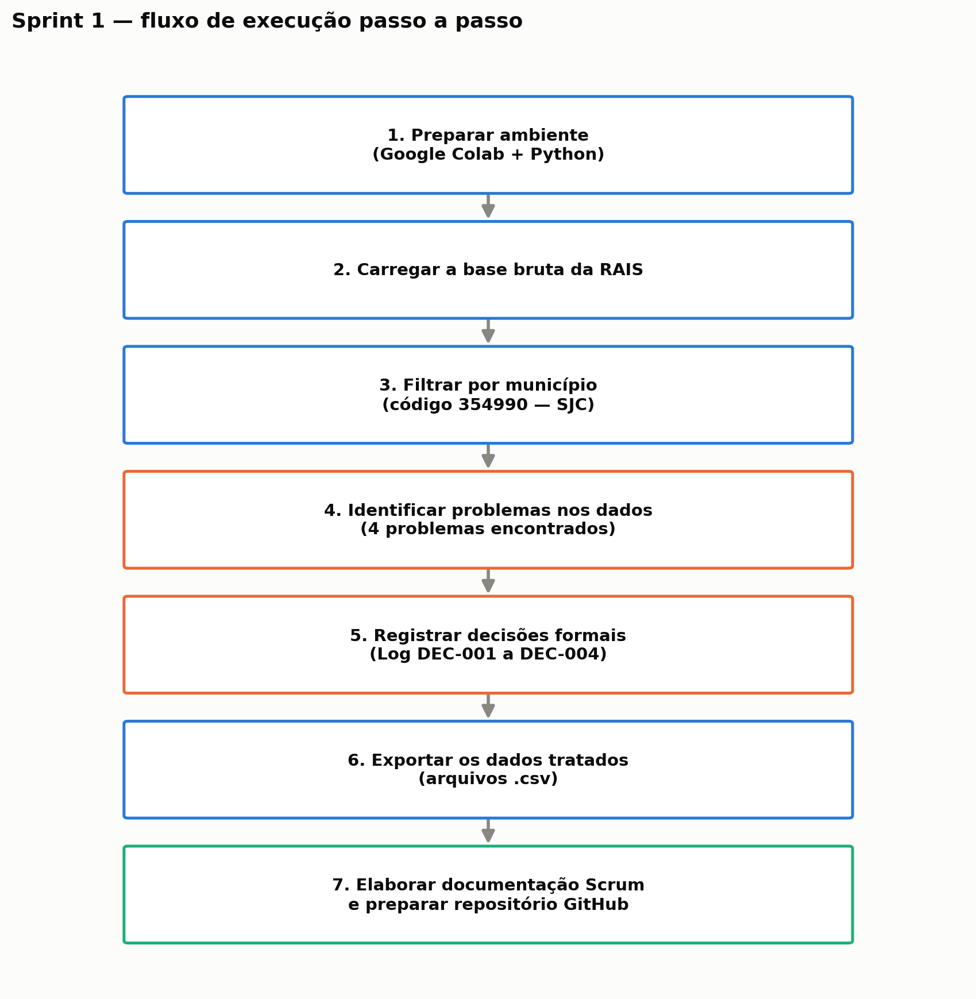
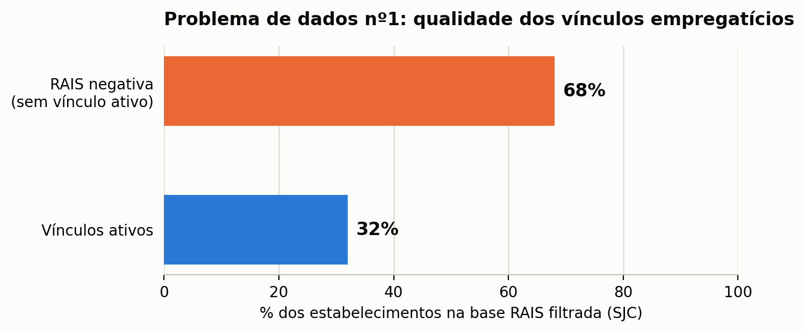
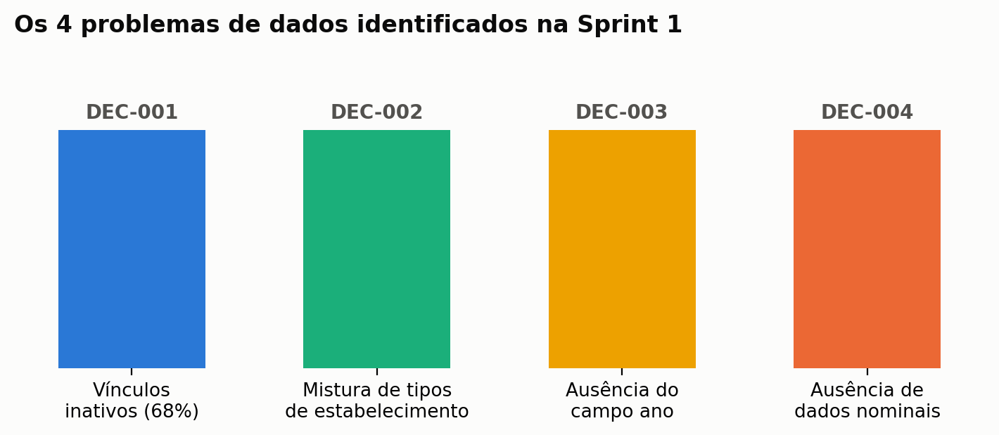

> Versão em Markdown de [`Relatorio_Detalhado_Sprint1_Observatorio_SJC.docx`](Relatorio_Detalhado_Sprint1_Observatorio_SJC.docx), para leitura direta no GitHub. Em caso de diferença, vale o .docx. · [voltar ao README](../README.md)

**Observatório do Ecossistema Industrial**

**e de Serviços de São José dos Campos**

Relatório Detalhado da Sprint 1 — passo a passo do que foi feito

Disciplina: API — Aprendizagem por Projetos Integrados

Curso de Logística — Fatec São José dos Campos

Aluno responsável: Juliano Souza Santana

Orientadores: Prof. José Jaétis (M2) · Prof. Marcus (P2)

Cliente: CADI e Secretaria de Desenvolvimento Econômico de São José dos Campos

Documento elaborado em 22 de setembro de 2026 · Entrega da Sprint 1: 28/09/2026

# 1. Introdução e Objetivo da Sprint 1

Este relatório descreve, em detalhe, tudo o que foi realizado na Sprint 1 do projeto do Observatório do Ecossistema Industrial e de Serviços de São José dos Campos. O objetivo é que qualquer leitor — em especial outro estudante — entenda não apenas o que foi entregue, mas como cada etapa foi executada e para que ela serve dentro do projeto como um todo.

A Sprint 1 é o primeiro ciclo de trabalho do projeto (de um total de 3 sprints) e teve como foco principal: preparar a base técnica do projeto, obter e tratar a primeira versão dos dados da RAIS, e formalizar toda a documentação inicial exigida pela metodologia Scrum adotada.

# 2. Planejamento da Sprint

Antes de iniciar o desenvolvimento, o trabalho da sprint foi organizado em um Backlog da Sprint — um recorte do Backlog do Produto com as User Stories escolhidas para esse ciclo. Para que uma User Story pudesse entrar em desenvolvimento, ela precisava atender ao DoR (Definition of Ready), o checklist de prontidão da equipe (por exemplo, ter uma fonte de dados definida e um objetivo claro).

| **User Story** | **Descrição**                                                                                   | **Status ao final da Sprint 1** |
|----------------|-------------------------------------------------------------------------------------------------|---------------------------------|
| US01           | Não detalhada neste registro — consultar o documento Backlog do Produto para a redação completa | Concluído                       |
| US02           | Não detalhada neste registro — consultar o documento Backlog do Produto para a redação completa | Concluído                       |
| US03           | Tratamento de inconsistências dos dados da RAIS                                                 | Concluído                       |
| US04           | Não detalhada neste registro — consultar o documento Backlog do Produto para a redação completa | Concluído                       |
| US05           | Não detalhada neste registro — consultar o documento Backlog do Produto para a redação completa | Concluído                       |

Nota: este relatório foi elaborado a partir do histórico de decisões e entregas do projeto. O texto integral de US01, US02, US04 e US05 está no documento Backlog do Produto (versão v3); aqui o foco é detalhar como o trabalho técnico da sprint foi executado.

# 3. Execução Passo a Passo

O diagrama abaixo resume a sequência de trabalho da Sprint 1. Cada etapa é detalhada nas subseções seguintes.

*Diagrama 1 — Fluxo de execução da Sprint 1, do ambiente de trabalho à entrega da documentação.*

## 3.1 Preparar o ambiente de trabalho

**O que foi feito:** configuração de um notebook no Google Colab, um ambiente de execução de código Python na nuvem.

**Como foi feito:** criação do notebook e importação das bibliotecas Python necessárias para leitura e manipulação de dados tabulares.

**Para que serve:** o Google Colab foi escolhido por não exigir instalação local, permitindo que qualquer pessoa (aluno, orientador ou avaliador) execute e revise o mesmo código a partir de qualquer computador com acesso à internet.

## 3.2 Carregar a base bruta da RAIS

**O que foi feito:** importação do arquivo de dados brutos da RAIS (Relação Anual de Informações Sociais), disponibilizado pelo Ministério do Trabalho e Emprego.

**Como foi feito:** leitura do arquivo diretamente no notebook Python, carregando os registros em uma estrutura de dados tabular para permitir filtros e análises.

**Para que serve:** a RAIS é a fonte primária de informações sobre estabelecimentos e vínculos empregatícios no Brasil, sendo a base de todo o restante do projeto — sem essa carga inicial, nenhuma análise seria possível.

## 3.3 Filtrar por município

**O que foi feito:** filtragem dos registros da base nacional da RAIS para manter apenas os estabelecimentos localizados em São José dos Campos.

**Como foi feito:** aplicação de um filtro pelo código de município do IBGE (354990, referente a São José dos Campos), resultando em 100% dos registros do recorte correspondendo corretamente ao município desejado.

**Para que serve:** a base nacional da RAIS contém milhões de registros de todo o Brasil; o filtro municipal é o que torna o volume de dados gerenciável e relevante para o escopo do projeto (o ecossistema de SJC).

## 3.4 Identificar problemas nos dados

**O que foi feito:** análise exploratória da base filtrada para identificar inconsistências e limitações antes de seguir para a modelagem no Power BI.

**Como foi feito:** inspeção dos campos disponíveis e contagem de ocorrências por categoria, o que revelou quatro problemas distintos, propositalmente inseridos pelo cliente/professores como parte da avaliação do projeto.

**Para que serve:** identificar problemas antes de construir o dashboard evita que o Observatório final apresente números incorretos ou enganosos ao usuário.

| **\#** | **Problema**      | **Descrição**                                                                   | **Por que importa**                                                                                                 |
|--------|-------------------|---------------------------------------------------------------------------------|---------------------------------------------------------------------------------------------------------------------|
| 1      | Vínculos inativos | 68% dos estabelecimentos estão em situação de RAIS negativa (sem vínculo ativo) | Um ranking de contratações que não distinguisse isso superestimaria a atividade econômica real                      |
| 2      | Mistura de tipos  | A base combina Cnpj, Caepf e Cno sem distinção clara                            | Tipos diferentes de estabelecimento têm naturezas jurídicas distintas e não deveriam ser somados sem critério       |
| 3      | Ausência do ano   | O arquivo não indica o ano de referência dos dados                              | Sem saber o ano, é impossível comparar a evolução ao longo do tempo ou informar corretamente o usuário do dashboard |
| 4      | Ausência de nomes | Nomes de empresas e CNPJs não constam nos dados públicos                        | Impede um ranking nominal de empresas, exigindo uma solução alternativa de agregação                                |

*Gráfico 1 — Proporção de estabelecimentos com vínculos ativos vs. RAIS negativa.*

*Gráfico 2 — Os 4 problemas de dados identificados na Sprint 1 e seus respectivos códigos de decisão.*

## 3.5 Registrar as decisões formais

**O que foi feito:** documentação de como cada um dos quatro problemas identificados seria tratado dali em diante.

**Como foi feito:** criação do Log de Decisões de Dados, um documento no qual cada decisão recebe um código sequencial (DEC-001, DEC-002, ...) acompanhado da decisão tomada e da justificativa.

**Para que serve:** registrar decisões formalmente evita que o mesmo problema seja discutido repetidamente e permite que qualquer pessoa entenda, meses depois, por que uma escolha técnica foi feita.

| **Código** | **Problema tratado**                  | **Decisão / encaminhamento**                                                                                                                                         |
|------------|---------------------------------------|----------------------------------------------------------------------------------------------------------------------------------------------------------------------|
| DEC-001    | Vínculos inativos (68% RAIS negativa) | Tratamento definido e documentado no log de decisões                                                                                                                 |
| DEC-002    | Mistura de tipos de estabelecimento   | Tratamento definido e documentado no log de decisões                                                                                                                 |
| DEC-003    | Ausência do campo ano                 | Rótulo provisório "a confirmar" até resposta do cliente sobre o ano de referência dos dados                                                                          |
| DEC-004    | Ausência de dados nominais            | Plano de contingência: construir o ranking de empresas agregado por setor/região em vez de por nome, caso o cliente não forneça dados identificados (impacta a US07) |

## 3.6 Exportar os dados tratados

**O que foi feito:** geração dos arquivos finais de dados já filtrados e documentados, prontos para serem usados na etapa de visualização.

**Como foi feito:** exportação de três arquivos .csv a partir do notebook, incluindo o arquivo principal RAIS_SJC_in\_.csv.

**Para que serve:** o formato .csv é amplamente compatível com o Power BI e outras ferramentas de análise, servindo como a "ponte" entre o tratamento em Python e a construção do dashboard.

## 3.7 Elaborar a documentação Scrum e preparar o GitHub

**O que foi feito:** produção de toda a suíte de documentos que formaliza o planejamento e o encerramento da Sprint 1, além da organização do repositório de código do projeto.

| **Documento / Item**                         | **Para que serve**                                                                                      |
|----------------------------------------------|---------------------------------------------------------------------------------------------------------|
| Visão e Escopo                               | Define o objetivo geral do projeto e os limites do que será (e não será) entregue                       |
| Backlog do Produto (11 User Stories)         | Lista priorizada de todas as funcionalidades previstas para o Observatório                              |
| Backlog da Sprint 1                          | Recorte das User Stories escolhidas especificamente para esta sprint                                    |
| DoR Checklist                                | Garante que uma User Story só comece a ser desenvolvida quando estiver de fato pronta para isso         |
| DoD                                          | Define os critérios que uma User Story precisa cumprir para ser considerada concluída                   |
| Log de Decisões de Dados (DEC-001 a DEC-004) | Registra formalmente o tratamento dado a cada problema de dados encontrado                              |
| Template de Relatório Técnico                | Padroniza a estrutura dos relatórios técnicos futuros do projeto                                        |
| Repositório GitHub (observatorio-sjc)        | Guarda e versiona notebooks, documentos e arquivos do Power BI, com pastas docs/, notebooks/ e powerbi/ |

# 4. Verificação com a Definition of Done (DoD)

Antes de encerrar a sprint, cada User Story foi confrontada com os critérios do DoD — os requisitos mínimos definidos para considerar uma entrega realmente concluída. As cinco User Stories da Sprint 1 (US01 a US05) foram verificadas e marcadas como Concluído no Backlog, incluindo a US03, cujo critério de conclusão exigia especificamente que os quatro problemas de dados estivessem identificados e com decisão formal registrada — condição atendida pelo Log de Decisões de Dados (DEC-001 a DEC-004).

# 5. Resultados e Entregáveis da Sprint 1

| **Entregável**                                          | **Status**                                     |
|---------------------------------------------------------|------------------------------------------------|
| Notebook de ETL executado com sucesso (Google Colab)    | Concluído                                      |
| 3 arquivos .csv com dados tratados e filtrados para SJC | Concluído                                      |
| 4 problemas de dados identificados e documentados       | Concluído                                      |
| Log de Decisões de Dados (DEC-001 a DEC-004)            | Concluído                                      |
| Documento de Visão e Escopo                             | Concluído                                      |
| Backlog do Produto e Backlog da Sprint 1                | Concluído                                      |
| DoR Checklist e DoD                                     | Concluído                                      |
| Scaffold do repositório GitHub                          | Concluído (push local pendente de confirmação) |

*Gráfico 3 — A Sprint 1 entregou 100% das User Stories planejadas (5 de 5).*

# 6. Retrospectiva da Sprint

## 6.1 O que funcionou bem

- O pipeline de ETL rodou sem erros já na primeira execução completa, filtrando corretamente 100% dos registros para o município.

- O registro formal das decisões (Log DEC-XXX) deixou claro, para qualquer leitor, o raciocínio por trás de cada escolha técnica.

## 6.2 Dificuldades encontradas

- A base de dados apresentou qualidade abaixo do esperado (RAIS negativa, mistura de tipos, ausência de ano e de identificação nominal), exigindo tempo adicional de análise antes de seguir para a modelagem.

- Duas das quatro decisões de dados (DEC-003 e DEC-004) dependem de respostas do cliente ainda não recebidas, o que mantém parte do escopo em aberto.

## 6.3 Aprendizados

- Vale sempre explorar a qualidade dos dados antes de avançar para a visualização — problemas encontrados cedo custam muito menos para corrigir.

- Ter um formato padrão de registro de decisões (DEC-XXX) economiza tempo de comunicação com orientadores e cliente.

# 7. Transição para a Sprint 2

Ao final da Sprint 1, ficam como pendências herdadas para os próximos ciclos:

- Resposta do cliente sobre o ano de referência dos dados da RAIS (DEC-003).

- Resposta do cliente sobre a possibilidade de fornecer dados identificados de empresas (DEC-004), o que definirá a abordagem final da US07.

- Confirmação, pelos professores, das datas oficiais de Sprint 2 e Sprint 3 (atualmente propostas, não confirmadas).

- Confirmação da execução do push do repositório observatorio-sjc para o GitHub.

- Início do desenvolvimento das User Stories US06 a US11 e da geocodificação por CEP para o mapeamento geográfico.
