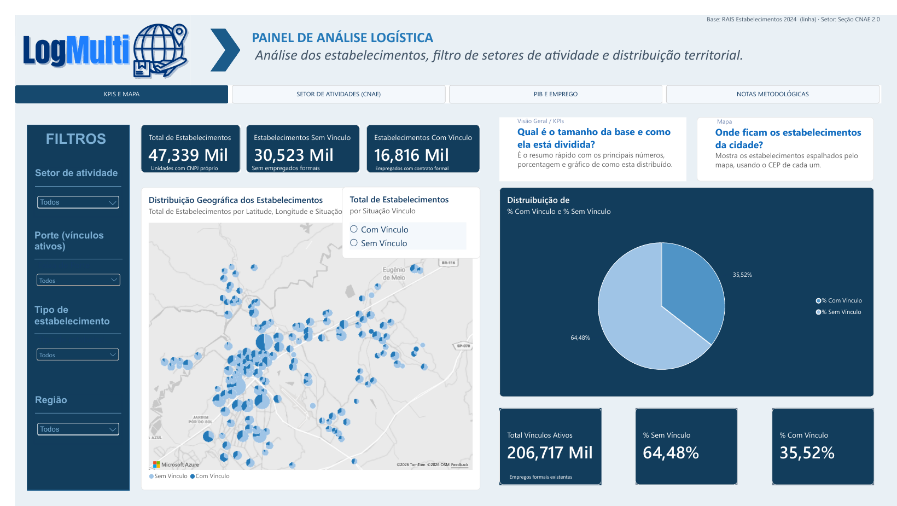
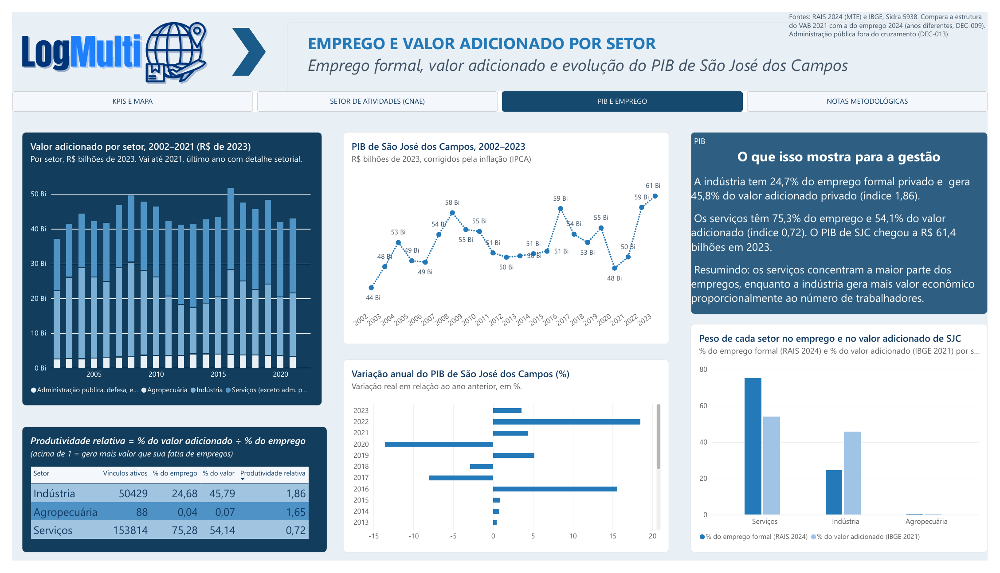

# Painel Power BI

## 🌐 Painel online

**[Abrir o painel publicado no Power BI](https://app.powerbi.com/view?r=eyJrIjoiMDdlOThiMzQtNWQ5Ny00Mzk1LWI0YWEtNGM2NzAzZmNhNDRmIiwidCI6ImVhYmU2NGM1LTY4ZjUtNGE3Ni04MzAxLTk1NzdhNjc5ZTQ0OSIsImMiOjR9)** — abre no navegador, sem instalar nada e sem login.

Versão de 26/10/2026, com as 4 páginas: **KPIs e Mapa · Setor de Atividades (CNAE) · PIB e Emprego · Notas Metodológicas**. É a mesma versão entregue na Sprint 3 (23/11/2026), com o mesmo link. **Em 23/11/2026 a planilha do mapa recebeu as coordenadas do CNEFE 2022 (99,99% dos estabelecimentos com ponto); o link publicado só mostra isso depois do passo a passo abaixo.**

## 🔄 Como atualizar o painel com o mapa novo (CNEFE 2022)

A aba **CEP x Região** de `fontes/Regioes_SJC_filtro_por_regiao.xlsx` agora tem as coordenadas do CNEFE 2022 (DEC-023): 3.676 dos 3.677 CEPs com ponto, contra 2.672 antes. Nenhuma coluna mudou de nome nem de lugar, então o painel não precisa de ajuste nos visuais, só de atualização:

1. Baixe o repositório atualizado (*Code → Download ZIP*) e extraia em `C:\Observatorio-SJC\` (ou ajuste o parâmetro `PastaFontes`, como explicado abaixo).
2. Abra `powerbi/pbip/Observatorio_SJC.pbip` no Power BI Desktop.
3. Clique em **Página Inicial → Atualizar**. Se aparecer erro só na tabela `PIB anual`, é a aba que falta em `fontes/` (aviso abaixo): para não perder essa tabela, atualize apenas a `CEP x Região` (painel **Dados**, botão direito na tabela → **Atualizar dados**).
4. Confira a página **KPIs e Mapa**: o mapa deve mostrar pontos também nas avenidas e no CEP `12230000` (Jardim Satélite), que antes ficavam vazios; os cartões devem aparecer sem "Mil".
5. **Arquivo → Publicar → Publicar no Power BI**, escolha o mesmo workspace e confirme **Substituir**. O link público continua o mesmo.
6. Tire novos prints das 4 páginas e salve em `evidencias/sprint3/`.

## Arquivos

| Arquivo / pasta | O que é |
|---|---|
| [`pbip/`](pbip/) | **Versão atual** do painel (a publicada), salva como projeto do Power BI (`.pbip`). Abra o arquivo `pbip/Observatorio_SJC.pbip` no Power BI Desktop |
| [`fontes/`](fontes/) | Planilhas que o painel atual lê: `RAIS_SJC.csv`, `Cruzamento_RAIS_IBGE_Observatorio_SJC.xlsx`, `dCNAE_classes.xlsx` e `Regioes_SJC_filtro_por_regiao.xlsx` |
| [`Powerbi_API_Sprint2.pdf`](Powerbi_API_Sprint2.pdf) | Versão atual exportada em PDF (4 páginas), para ver sem o Power BI |
| [`versoes_anteriores/`](versoes_anteriores/) | `Powerbi_API_Sprint2.pbix` e `.pbit` (2 páginas: KPIs e Mapa, Setor de Atividades) e `PowerbiATT_Api_Sprint2.pbix` (páginas de PIB e de notas, que foram juntadas na versão atual) |

Documentação do painel: [relatório do Power BI](../docs/Relatorio_PowerBI_Sprint2.md) (fontes e leitura de cada visual) e [fórmulas DAX e Power Query](../docs/Formulas_PowerBI_Sprint2.md).

### Como abrir a versão `.pbip`

1. Baixe o repositório inteiro (*Code → Download ZIP*) e extraia, de preferência, em `C:\Observatorio-SJC\`. As pastas `Observatorio_SJC.Report` e `Observatorio_SJC.SemanticModel` precisam ficar ao lado do arquivo `.pbip`.
2. Abra `powerbi/pbip/Observatorio_SJC.pbip` no Power BI Desktop.
3. Todas as consultas leem os arquivos pelo parâmetro **`PastaFontes`**, que vem com o valor `C:\Observatorio-SJC\powerbi\fontes\`. Se você extraiu o repositório em outro lugar, vá em **Página Inicial → Transformar dados → Editar parâmetros**, cole o caminho da sua pasta `powerbi\fontes\` (com a barra `\` no final) e clique em **Atualizar**.

> ⚠️ **Tabela `PIB anual`:** lê a aba "PIB anual" da planilha `Cruzamento_RAIS_IBGE_Observatorio_SJC.xlsx`, mas a cópia que está em `fontes/` não tem essa aba (só a versão do computador de quem montou o painel tem). Até a planilha completa ser enviada para `fontes/`, a atualização dessa tabela dá erro; as outras cinco atualizam normalmente.

## Telas

### Página 1 — KPIs e Mapa

### Página 2 — Setor de Atividades (CNAE)

### Página 3 — PIB e Emprego

### Página 4 — Notas Metodológicas

## O que mudou em 23/11/2026 (organização dos arquivos)

- Novo parâmetro **`PastaFontes`** no Power Query: as 6 consultas passaram a ler `PastaFontes & "arquivo"` no lugar de caminhos do computador de uma integrante (`C:\Users\thaly\Desktop\...` e `C:\Users\thaly\Downloads\...`). A planilha `Cruzamento_RAIS_IBGE_Observatorio_SJC (1).xlsx` passou a ser lida pelo nome sem "(1)", que é o arquivo de `fontes/`.
- Projeto renomeado de `Powerbi Sprint2` para **`Observatorio_SJC`** (arquivo `.pbip`, pastas `.Report` e `.SemanticModel`).
- Versões `.pbix` e `.pbit` antigas movidas para `versoes_anteriores/`.
- Nenhum visual, medida ou relação foi alterado. O painel publicado continua o mesmo, no mesmo link.
- **Coordenadas do mapa (DEC-023):** as colunas Latitude e Longitude da aba `CEP x Região` (`fontes/Regioes_SJC_filtro_por_regiao.xlsx`) passaram a vir do CNEFE 2022 do IBGE. A região de cada CEP não mudou. A versão anterior da planilha fica no histórico do Git.

## O que mudou na Sprint 2 em relação à versão anterior

- As páginas **PIB e Emprego** e **Notas Metodológicas** foram juntadas à versão principal (cruzamento com o IBGE — US09).
- O mapa passou a usar **latitude e longitude** da geocodificação do grupo (tabela `CEP x Região`), em vez do texto do CEP (DEC-022).
- Novo filtro **Região** (Centro, Norte, Sul, Leste, Sudeste e Oeste), pela tabela `CEP x Região` ligada à `RAIS_SJC` pelo CEP.
- Nova tabela `dCNAE` com o nome oficial das 673 classes: nenhum setor aparece mais só com o número do código (coluna `Setor Completo`).
- Página 2 ganhou o gráfico **Indústria (Seção C): empregos CLT por setor**, e a tabela por porte passou a mostrar a base inteira (206.626 vínculos CLT).

## Ajustes visuais da página 1 (feitos em 23/11/2026 no `.pbip`)

- ✅ **Cartões sem "Mil":** os cartões Total de Estabelecimentos, Sem Vínculo, Com Vínculo e Total de Vínculos Ativos passaram a usar a unidade de exibição **Nenhum**. Antes apareciam "47,339 Mil", "30,523 Mil", "16,816 Mil" e "206,717 Mil"; agora aparecem 47.339, 30.523, 16.816 e 206.717.
- ✅ **Título da pizza:** "Distruibuição de" → "Distribuição dos estabelecimentos por situação de vínculo".
- ✅ **Subtítulos dos cartões:** "Unidades com CNPJ próprio" → "Estabelecimentos na base" (o total inclui CAEPF e CNO) e "Empregados com contrato formal" → "Com empregados no ano" (o cartão conta estabelecimentos, não pessoas).

> ⚠️ Os ajustes estão no projeto `.pbip` do repositório. O **link publicado só muda depois que alguém abrir o `.pbip` no Power BI Desktop, conferir a página 1 e clicar em Publicar** (substituindo o relatório no mesmo workspace, para manter o link).

Ainda pendente:

- **Relação automática** `Cruzamento[vab_real_2023] → 'VAB setorial'[vab_real_2023]`: foi criada pelo Power BI sobre uma coluna de valor, não de chave. Conferir se algum visual depende dela; se não, pode ser excluída.

## Melhorias sugeridas para a versão final

- **Fonte da tabela RAIS_SJC:** trocar pela base única `dados/RAIS_SJC_2024_PowerBI.csv` (DEC-022), que já tem latitude, longitude e região na mesma linha; a planilha de regiões do painel deixa 603 estabelecimentos sem região, a base única deixa 5.
- **Página "Regiões":** vínculos e estabelecimentos por região oficial, tipo de atividade, intensidade tecnológica (OCDE) e porte SEBRAE, com as colunas que já estão na base única.

Lista completa, com o esforço de cada item, no [Relatório da Sprint 3](../docs/RELATORIO_SPRINT_3.md#6-melhorias-sugeridas).
