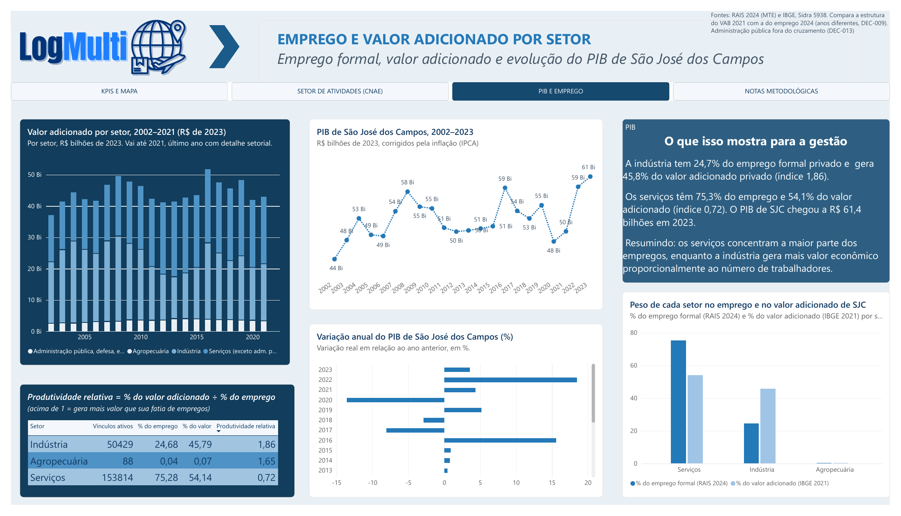
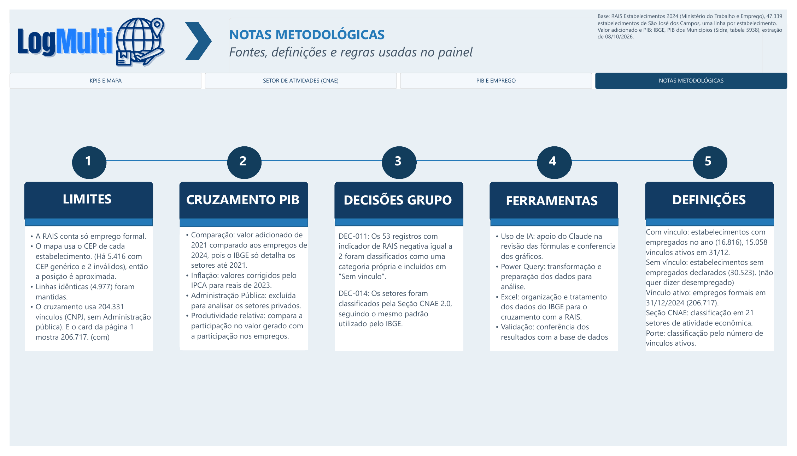

# Painel Power BI

## 🌐 Painel online

**[Abrir o painel publicado no Power BI](https://app.powerbi.com/view?r=eyJrIjoiMDdlOThiMzQtNWQ5Ny00Mzk1LWI0YWEtNGM2NzAzZmNhNDRmIiwidCI6ImVhYmU2NGM1LTY4ZjUtNGE3Ni04MzAxLTk1NzdhNjc5ZTQ0OSIsImMiOjR9)** — abre no navegador, sem instalar nada e sem login.

Versão de 26/10/2026, com as 4 páginas: **KPIs e Mapa · Setor de Atividades (CNAE) · PIB e Emprego · Notas Metodológicas**.

## Arquivos

| Arquivo / pasta | O que é |
|---|---|
| [`pbip/`](pbip/) | **Versão atual** do painel (a publicada), salva como projeto do Power BI (`.pbip`). Abra o arquivo `pbip/Powerbi Sprint2.pbip` no Power BI Desktop |
| [`fontes/`](fontes/) | Planilhas que o painel atual lê: `RAIS_SJC.csv`, `Cruzamento_RAIS_IBGE_Observatorio_SJC.xlsx`, `dCNAE_classes.xlsx` e `Regioes_SJC_filtro_por_regiao.xlsx` |
| [`Powerbi_API_Sprint2.pdf`](Powerbi_API_Sprint2.pdf) | Versão atual exportada em PDF (4 páginas), para ver sem o Power BI |
| [`Powerbi_API_Sprint2.pbix`](Powerbi_API_Sprint2.pbix) · [`.pbit`](Powerbi_API_Sprint2.pbit) | Versão anterior (2 páginas: KPIs e Mapa, Setor de Atividades) |
| [`PowerbiATT_Api_Sprint2.pbix`](PowerbiATT_Api_Sprint2.pbix) | Versão anterior com as páginas de PIB e de notas, que foram juntadas na versão atual |

Documentação do painel: [relatório do Power BI](../docs/Relatorio_PowerBI_Sprint2.md) (fontes e leitura de cada visual) e [fórmulas DAX e Power Query](../docs/Formulas_PowerBI_Sprint2.md).

### Como abrir a versão `.pbip`

1. Baixe a pasta `powerbi/` inteira (as pastas `.Report` e `.SemanticModel` precisam ficar ao lado do arquivo `.pbip`).
2. Abra `pbip/Powerbi Sprint2.pbip` no Power BI Desktop.
3. As consultas apontam para caminhos do computador de quem montou o painel (`C:\Users\thaly\...`). Para atualizar os dados, vá em **Transformar dados → Configurações da fonte de dados → Alterar fonte** e aponte cada fonte para o arquivo correspondente em `powerbi/fontes/`.

## Telas

### Página 1 — KPIs e Mapa

### Página 2 — Setor de Atividades (CNAE)

### Página 3 — PIB e Emprego

### Página 4 — Notas Metodológicas

## O que mudou em relação à versão anterior

- As páginas **PIB e Emprego** e **Notas Metodológicas** foram juntadas à versão principal (cruzamento com o IBGE — US09).
- O mapa passou a usar **latitude e longitude** da geocodificação do grupo (tabela `CEP x Região`), em vez do texto do CEP (DEC-022).
- Novo filtro **Região** (Centro, Norte, Sul, Leste, Sudeste e Oeste), pela tabela `CEP x Região` ligada à `RAIS_SJC` pelo CEP.
- Nova tabela `dCNAE` com o nome oficial das 673 classes: nenhum setor aparece mais só com o número do código (coluna `Setor Completo`).
- Página 2 ganhou o gráfico **Indústria (Seção C): empregos CLT por setor**, e a tabela por porte passou a mostrar a base inteira (206.626 vínculos CLT).

## Ajustes pequenos para a Sprint 3

Vistos nas telas da versão publicada:

- **Cartões com "Mil":** aparecem "47,339 Mil", "30,523 Mil", "16,816 Mil" e "206,717 Mil", que se leem como decimais. Em *Formato → Valor do balão → Unidades de exibição*, usar **Nenhum** para mostrar 47.339, 30.523, 16.816 e 206.717.
- **Título da pizza:** "Distruibuição de" → "Distribuição".
- **Subtítulos dos cartões:** "Unidades com CNPJ próprio" (o total inclui CAEPF e CNO; sugerido: "Estabelecimentos na base") e "Empregados com contrato formal" (o cartão conta estabelecimentos, não pessoas; sugerido: "Estabelecimentos com empregados no ano").
- **Relação automática** `Cruzamento[vab_real_2023] → 'VAB setorial'[vab_real_2023]`: foi criada pelo Power BI sobre uma coluna de valor, não de chave. Conferir se algum visual depende dela; se não, pode ser excluída.
- Trocar os caminhos `C:\Users\...` das fontes por uma pasta do projeto, para qualquer integrante conseguir atualizar o painel.
