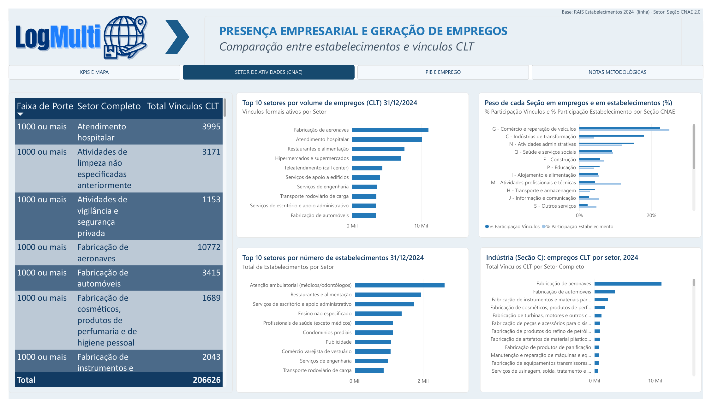
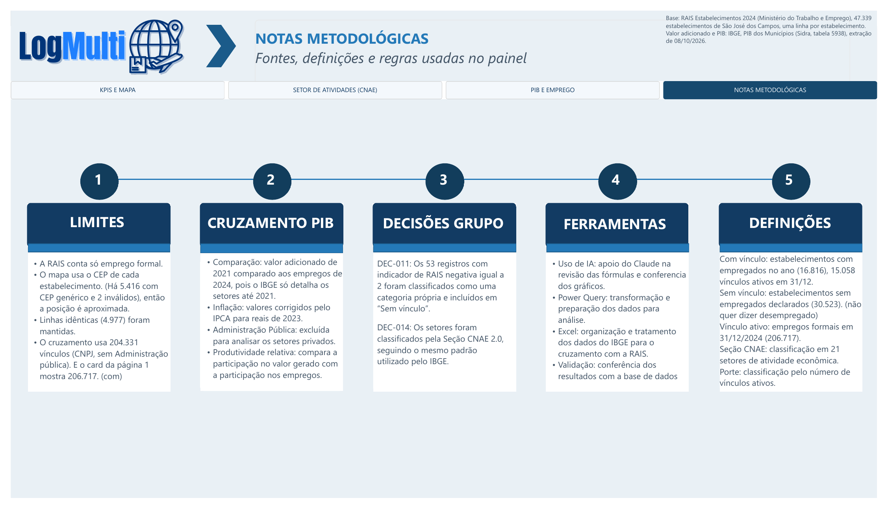

# Painel Power BI

## 🌐 Painel online

**[Abrir o painel publicado no Power BI](https://app.powerbi.com/view?r=eyJrIjoiMDdlOThiMzQtNWQ5Ny00Mzk1LWI0YWEtNGM2NzAzZmNhNDRmIiwidCI6ImVhYmU2NGM1LTY4ZjUtNGE3Ni04MzAxLTk1NzdhNjc5ZTQ0OSIsImMiOjR9)** — abre no navegador, sem instalar nada e sem login.

O link publicado mostra a versão de 26/10/2026, com 4 páginas: **KPIs e Mapa · Setor de Atividades (CNAE) · PIB e Emprego · Notas Metodológicas**. O projeto `.pbip` deste repositório já tem a versão da Sprint 3, com **5 páginas** (nova: **Regiões e Tecnologia**) e o mapa com 99,99% dos estabelecimentos. O link só mostra isso depois do passo a passo abaixo.

## 🔄 Como atualizar e republicar o painel (Sprint 3)

O projeto `.pbip` tem mudanças que o link publicado ainda não mostra:

- **Mapa:** coordenadas do CNEFE 2022 na aba `CEP x Região` (DEC-023), com ponto para 99,99% dos estabelecimentos.
- **Página nova, Regiões e Tecnologia:** vínculos por região, por tipo de atividade, por intensidade tecnológica (OCDE) e por macroprocesso logístico (DEC-024).
- **Página 1:** cartões sem "Mil", título da pizza corrigido e dois subtítulos novos.
- **Aba PIB anual:** agora está na planilha de `fontes/`, então todas as 6 tabelas atualizam a partir do repositório.

Passo a passo:

1. Baixe o repositório atualizado (*Code → Download ZIP*) e extraia em `C:\Observatorio-SJC\` (ou ajuste o parâmetro `PastaFontes`, como explicado abaixo).
2. Abra `powerbi/pbip/Observatorio_SJC.pbip` no Power BI Desktop.
3. Clique em **Página Inicial → Atualizar**. É preciso atualizar tudo: o cache de dados não vai para o GitHub, e as colunas calculadas novas só são preenchidas na atualização.
4. Confira as páginas:
    - **KPIs e Mapa:** pontos também nas avenidas e no CEP `12230000`; cartões sem "Mil".
    - **Regiões e Tecnologia:** os 4 gráficos preenchidos. A soma de "Vínculos por tipo de atividade" deve dar 206.717.
    - **PIB e Emprego:** PIB de R$ 61 bi em 2023 e variação de -13,5% em 2020, como antes.
5. **Arquivo → Publicar → Publicar no Power BI**, escolha o mesmo workspace e confirme **Substituir**. O link público continua o mesmo.
6. Tire novos prints das 5 páginas e salve em `evidencias/sprint3/`.

## Arquivos

| Arquivo / pasta | O que é |
|---|---|
| [`pbip/`](pbip/) | **Versão atual** do painel (a publicada), salva como projeto do Power BI (`.pbip`). Abra o arquivo `pbip/Observatorio_SJC.pbip` no Power BI Desktop |
| [`fontes/`](fontes/) | Planilhas que o painel lê: `RAIS_SJC.csv`, `Cruzamento_RAIS_IBGE_Observatorio_SJC.xlsx` (abas Cruzamento, VAB setorial e PIB anual), `dCNAE_classes.xlsx` e `Regioes_SJC_filtro_por_regiao.xlsx` (aba CEP x Região) |
| [`Powerbi_API_Sprint2.pdf`](Powerbi_API_Sprint2.pdf) | Versão publicada em 26/10/2026 exportada em PDF (4 páginas), para ver sem o Power BI |
| [`versoes_anteriores/`](versoes_anteriores/) | `Powerbi_API_Sprint2.pbix` e `.pbit` (2 páginas: KPIs e Mapa, Setor de Atividades) e `PowerbiATT_Api_Sprint2.pbix` (páginas de PIB e de notas, que foram juntadas na versão atual) |

Documentação do painel: [relatório do Power BI](../docs/final/Relatorio_PowerBI_Final.md) (fontes e leitura de cada visual) e [fórmulas DAX e Power Query](../docs/final/Formulas_PowerBI_Final.md).

### Como abrir a versão `.pbip`

1. Baixe o repositório inteiro (*Code → Download ZIP*) e extraia, de preferência, em `C:\Observatorio-SJC\`. As pastas `Observatorio_SJC.Report` e `Observatorio_SJC.SemanticModel` precisam ficar ao lado do arquivo `.pbip`.
2. Abra `powerbi/pbip/Observatorio_SJC.pbip` no Power BI Desktop.
3. Todas as consultas leem os arquivos pelo parâmetro **`PastaFontes`**, que vem com o valor `C:\Observatorio-SJC\powerbi\fontes\`. Se você extraiu o repositório em outro lugar, vá em **Página Inicial → Transformar dados → Editar parâmetros**, cole o caminho da sua pasta `powerbi\fontes\` (com a barra `\` no final) e clique em **Atualizar**.

## Telas

### Página 1 — KPIs e Mapa

### Página 2 — Setor de Atividades (CNAE)

### Página 3 — PIB e Emprego

### Página 4 — Notas Metodológicas

## O que mudou em 23/11/2026 (organização dos arquivos)

- Novo parâmetro **`PastaFontes`** no Power Query: as 6 consultas passaram a ler `PastaFontes & "arquivo"` no lugar de caminhos do computador de uma integrante (`C:\Users\thaly\Desktop\...` e `C:\Users\thaly\Downloads\...`). A planilha `Cruzamento_RAIS_IBGE_Observatorio_SJC (1).xlsx` passou a ser lida pelo nome sem "(1)", que é o arquivo de `fontes/`.
- Projeto renomeado de `Powerbi Sprint2` para **`Observatorio_SJC`** (arquivo `.pbip`, pastas `.Report` e `.SemanticModel`).
- Versões `.pbix` e `.pbit` antigas movidas para `versoes_anteriores/`.
- Nenhum visual, medida ou relação foi alterado. O painel publicado continua o mesmo, no mesmo link.
- **Coordenadas do mapa (DEC-023):** as colunas Latitude e Longitude da aba `CEP x Região` (`fontes/Regioes_SJC_filtro_por_regiao.xlsx`) passaram a vir do CNEFE 2022 do IBGE. A região de cada CEP não mudou. A versão anterior da planilha fica no histórico do Git.

## O que mudou na Sprint 2 em relação à versão anterior

- As páginas **PIB e Emprego** e **Notas Metodológicas** foram juntadas à versão principal (cruzamento com o IBGE — US09).
- O mapa passou a usar **latitude e longitude** da geocodificação do grupo (tabela `CEP x Região`), em vez do texto do CEP (DEC-022).
- Novo filtro **Região** (Centro, Norte, Sul, Leste, Sudeste e Oeste), pela tabela `CEP x Região` ligada à `RAIS_SJC` pelo CEP.
- Nova tabela `dCNAE` com o nome oficial das 673 classes: nenhum setor aparece mais só com o número do código (coluna `Setor Completo`).
- Página 2 ganhou o gráfico **Indústria (Seção C): empregos CLT por setor**, e a tabela por porte passou a mostrar a base inteira (206.626 vínculos CLT).

## Página nova: Regiões e Tecnologia (23/11/2026)

Responde às perguntas 2, 3, 4 e 5 do documento de requisitos do cliente (ver [`docs/final/Respostas_Requisitos_Cliente.md`](../docs/final/Respostas_Requisitos_Cliente.md)). Fica entre PIB e Emprego e Notas Metodológicas.

| Visual | O que mostra |
|---|---|
| Filtro de região | Filtra todos os gráficos da página pela região oficial |
| Vínculos ativos por região oficial | Onde estão os empregos formais |
| Vínculos por tipo de atividade | Manufatura, comércio, logística, tecnologia etc. (categorias do cliente) |
| Vínculos por intensidade tecnológica (OCDE) | Alta, média-alta, média, média-baixa e "não se aplica" |
| Vínculos por macroprocesso logístico | Etapa da cadeia de suprimentos, do suprimento à logística reversa (DEC-024) |
| O que isso mostra para a gestão | Três leituras com os números da página |

Os gráficos usam três **colunas calculadas** novas na tabela `RAIS_SJC`: `Tipo de Atividade`, `Intensidade Tecnológica OCDE` e `Macroprocesso Logístico`. Elas seguem a mesma regra da base única (notebook 02) e saem da coluna `Classe Chave` (classe CNAE com 5 dígitos).

## Ajustes visuais da página 1 (feitos em 23/11/2026 no `.pbip`)

- ✅ **Cartões sem "Mil":** os cartões Total de Estabelecimentos, Sem Vínculo, Com Vínculo e Total de Vínculos Ativos passaram a usar a unidade de exibição **Nenhum**. Antes apareciam "47,339 Mil", "30,523 Mil", "16,816 Mil" e "206,717 Mil"; agora aparecem 47.339, 30.523, 16.816 e 206.717.
- ✅ **Título da pizza:** "Distruibuição de" → "Distribuição dos estabelecimentos por situação de vínculo".
- ✅ **Subtítulos dos cartões:** "Unidades com CNPJ próprio" → "Estabelecimentos na base" (o total inclui CAEPF e CNO) e "Empregados com contrato formal" → "Com empregados no ano" (o cartão conta estabelecimentos, não pessoas).

> ⚠️ Os ajustes estão no projeto `.pbip` do repositório. O **link publicado só muda depois que alguém abrir o `.pbip` no Power BI Desktop, conferir a página 1 e clicar em Publicar** (substituindo o relatório no mesmo workspace, para manter o link).

Ainda pendente:

- **Relação automática** `Cruzamento[vab_real_2023] → 'VAB setorial'[vab_real_2023]`: foi criada pelo Power BI sobre uma coluna de valor, não de chave. Conferir se algum visual depende dela; se não, pode ser excluída.

## Melhorias sugeridas para a versão final

- **Fonte da tabela RAIS_SJC:** trocar pela base única `dados/RAIS_SJC_2024_PowerBI.csv` (DEC-022), que já tem latitude, longitude e região na mesma linha; a planilha de regiões do painel deixa 603 estabelecimentos sem região, a base única deixa 5.

Lista completa, com o esforço de cada item, no [Relatório da Sprint 3](../docs/sprint-3/RELATORIO_SPRINT_3.md#6-melhorias-sugeridas).
